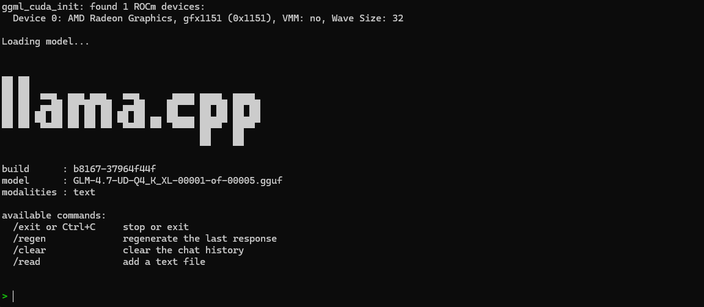
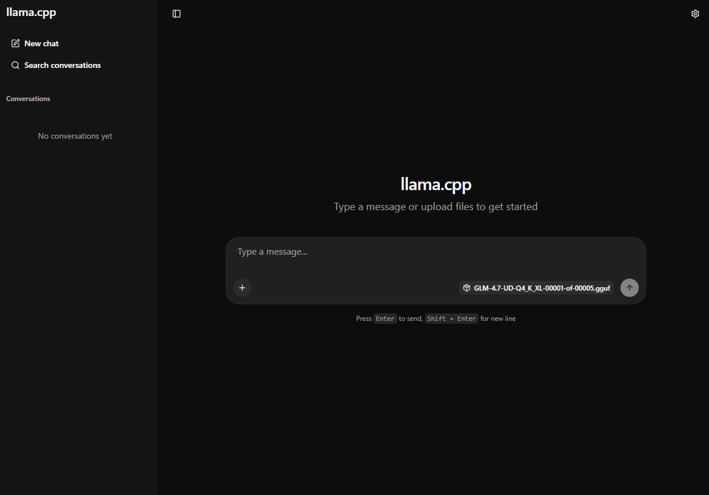

<!--
Copyright Advanced Micro Devices, Inc.

SPDX-License-Identifier: MIT
-->

<!-- @github-only -->
> [!IMPORTANT]
> This playbook uses special tags that GitHub cannot render. Please visit [amd.com/playbooks](https://amd.com/playbooks) to correctly preview this content.
<!-- @github-only:end -->

# Clustering Two Ryzen™ AI Halos with RPC over USB4

## Overview

Your Ryzen™ AI Halo is already capable of running large language models locally. Clustering takes this further by combining the GPU memory of multiple systems, giving you access to even larger models with stronger reasoning, better code generation, and deeper multilingual understanding, all entirely on your own hardware.

This playbook teaches you how to cluster two Ryzen AI Halo systems connected directly with a single USB4/Thunderbolt™ cable, with no network switch required. Using llama.cpp's RPC engine, you will run GLM 4.7, a 358B parameter model, across both machines with AMD ROCm™ acceleration.

## What You'll Learn

- How to extend VRAM allocation on Ryzen AI Halo systems
- Setting up a direct USB4/Thunderbolt network link between two systems
- Installing llama.cpp with ROCm and RPC support
- Configuring an RPC worker and launching distributed inference across two nodes
- Running a 358B parameter model across two Ryzen AI Halo systems

## Setting the Memory Configuration

> **Note**: Complete this step on both Machine 1 and Machine 2.

On Linux, ROCm utilizes a shared system memory pool, and this pool is configured by default to half the system memory.

This amount can be increased by changing the kernel's Translation Table Manager (TTM) page setting, with the following instructions. AMD recommends setting the minimum dedicated VRAM in the BIOS (0.5 GB).

* Install the pipx utility and add the path for pipx installed wheels into the system search path.

  ```bash
  sudo apt install pipx
  pipx ensurepath
  ```

* Install the amd-debug-tools wheel from PyPI.
  ```bash
  pipx install amd-debug-tools
  ```

* Run the amd-ttm tool to query the current settings for shared memory.
  ```bash
  amd-ttm
  ```

* Reconfigure shared memory settings to **120 GB**:
  ```bash
  amd-ttm --set 120
  ```

* Reboot the system for changes to take effect.

<!-- @device:halo_box -->
## Check for Software Updates

<!-- @require:software-update -->
<!-- @device:end -->
## Prerequisites

### Hardware

This playbook requires two Ryzen AI Halo units connected directly to each other with one USB4/Thunderbolt cable.

| Component | Quantity | Description |
|-----------|----------|-------------|
| Ryzen AI Halo | 2 | Compute nodes that form the cluster |
| USB4/Thunderbolt cable | 1 | Connects the two Halo units directly (USB4 40Gbps, Thunderbolt 3, or Thunderbolt 4 certified) |

> **Note**: The cable must be rated for 40Gbps data. USB-C charging cables and USB 3.x cables will not establish a network link between the two units.

> **Note**: Each Halo unit should keep its regular Ethernet or Wi-Fi connection for internet access and model downloads. The USB4 link carries only the traffic between the two nodes.

### Software

```bash
sudo apt install git cmake python3 python3-pip
```

## Physical Hardware Setup

> **Note**: Complete this step on both Machine 1 and Machine 2.

Connect the two Ryzen AI Halo units using the USB4/Thunderbolt cable, plugging each end into a USB4 port. This establishes a direct point-to-point link between the nodes.

Over this cable, Linux creates a virtual network interface named `thunderbolt0`, which carries regular network traffic just like an Ethernet port.

### 1. Confirm the Cable Is Detected

```bash
ip -br link show thunderbolt0
```

The interface should be `UP`:

```bash
thunderbolt0     UP             02:c6:d6:17:b8:d8 <BROADCAST,MULTICAST,UP,LOWER_UP>
```

> **Note**: If `thunderbolt0` is missing or not `UP`, check that the cable is seated in a USB4 port on both machines and is rated for 40Gbps data.

### 2. Assign Static IP Addresses

NetworkManager brings `thunderbolt0` up automatically, but with a random `169.254.x.x` link-local address that can change between reboots. Assign each machine a fixed address on a private subnet so the controller can always reach the RPC worker. This is a one-time step, and the setting persists across reboots.

On **Machine 1**:

```bash
sudo nmcli con add type ethernet ifname thunderbolt0 con-name usb4-cluster \
  ipv4.method manual ipv4.addresses 10.55.0.1/24 \
  connection.autoconnect-priority 10
sudo nmcli con up usb4-cluster
```

On **Machine 2**:

```bash
sudo nmcli con add type ethernet ifname thunderbolt0 con-name usb4-cluster \
  ipv4.method manual ipv4.addresses 10.55.0.2/24 \
  connection.autoconnect-priority 10
sudo nmcli con up usb4-cluster
```

| Flag | Purpose |
|------|---------|
| `ifname thunderbolt0` | Binds the connection profile to the USB4 network interface |
| `ipv4.method manual` | Disables automatic addressing in favor of a static address |
| `ipv4.addresses` | Static IP address for this machine on the USB4 link |
| `connection.autoconnect-priority 10` | Takes precedence over NetworkManager's automatic link-local profile, so the static address is applied after every reboot |

> **Note**: If your local network already uses the `10.55.0.x` range, choose another private subnet (for example, `10.66.0.x`) and substitute it in the commands throughout this playbook.

Confirm the address was applied:

```bash
ip -br addr show thunderbolt0
```

You should see `10.55.0.1/24` on Machine 1 and `10.55.0.2/24` on Machine 2.

### 3. Verify the Connection

From Machine 1, ping Machine 2 over the USB4 link:

```bash
ping -c 3 10.55.0.2
```

You should see all packets received:

```bash
3 packets transmitted, 3 received, 0% packet loss
```

## Installing llama.cpp

> **Note**: Complete this step on both Machine 1 and Machine 2.

Two installation options are available:

- [Option 1: Lemonade SDK (Recommended)](#option-1-lemonade-sdk-recommended) - pre-built binaries, fastest setup
- [Option 2: Manual Source Build](#option-2-manual-source-build) - build from source with full control over build flags

### Option 1: Lemonade SDK (Recommended)

The Lemonade SDK provides nightly builds of llama.cpp with AMD ROCm 7 acceleration, targeting GPUs such as gfx1151 (Strix Halo / Ryzen AI Max+ 395) and other recent Radeon architectures.

#### Step 1: Download the Pre-Built Binaries

Navigate to the latest release page and download the archive matching your platform and GPU target:

[https://github.com/lemonade-sdk/llamacpp-rocm/releases/latest/](https://github.com/lemonade-sdk/llamacpp-rocm/releases/latest/)

Download the file named `llama-bxxxx-ubuntu-rocm-gfx1151-x64.zip` (where `xxxx` is the build number).

#### Step 2: Extract and Prepare the Binaries

```bash
unzip llama-bxxxx-ubuntu-rocm-gfx1151-x64.zip
cd llama-bxxxx-ubuntu-rocm-gfx1151-x64
chmod +x llama-cli llama-server rpc-server
```

This directory now contains ROCm-enabled builds of `llama-cli`, `llama-server`, and `rpc-server`, precompiled for your Ryzen AI Halo system.

#### Step 3: Verify GPU Detection

```bash
./llama-cli --list-devices
```

Expected output:

```bash
ggml_cuda_init: found 1 ROCm devices:
  Device 0: AMD Radeon Graphics, gfx1151 (0x1151), VMM: no, Wave Size: 32
Available devices:
ggml_backend_cuda_get_available_uma_memory: final available_memory_kb: 127697544
  ROCm0: AMD Radeon Graphics (120000 MiB, 124704 MiB free)
```

With llama.cpp prepared on each node, proceed to [Downloading the Model](#downloading-the-model).

### Option 2: Manual Source Build

#### Step 1: Build llama.cpp

Clone the repository:

```bash
git clone https://github.com/ggml-org/llama.cpp
cd llama.cpp
```

Build with ROCm and RPC support:

```bash
cmake -B rocm -DGGML_HIP=ON -DGGML_RPC=ON -DAMDGPU_TARGETS="gfx1151"
cmake --build rocm --config Release -j$(nproc)
```

| Build Flag | Purpose |
|-----------|---------|
| `-DGGML_HIP=ON` | Enables the ROCm software stack |
| `-DGGML_RPC=ON` | Enables RPC for distributed inference |
| `-DAMDGPU_TARGETS="gfx1151"` | Targets the Ryzen AI Halo GPU (Radeon 8060s) |

For more build options, refer to the [llama.cpp build documentation](https://github.com/ggml-org/llama.cpp/blob/master/docs/build.md).

#### Step 2: Verify GPU Detection

```bash
cd rocm/bin
./llama-cli --list-devices
```

Expected output:

```bash
ggml_cuda_init: found 1 ROCm devices:
  Device 0: AMD Radeon Graphics, gfx1151 (0x1151), VMM: no, Wave Size: 32
Available devices:
ggml_backend_cuda_get_available_uma_memory: final available_memory_kb: 127697544
  ROCm0: AMD Radeon Graphics (120000 MiB, 124704 MiB free)
```

With llama.cpp prepared on each node, proceed to [Downloading the Model](#downloading-the-model).

## Downloading the Model

This playbook uses [GLM 4.7](https://huggingface.co/zai-org/GLM-4.7), a 358B parameter model in the `Q4_K_XL` quantization from [Unsloth](https://huggingface.co/unsloth/GLM-4.7-GGUF/tree/main/UD-Q4_K_XL). At this quantization the model requires approximately 205GB of storage and fits within the combined GPU memory of two Ryzen AI Halo nodes.

Download the GGUF files using the Hugging Face CLI:

```bash
pip install huggingface-hub
hf download unsloth/GLM-4.7-GGUF --include "UD-Q4_K_XL/*" --local-dir GLM-4.7-GGUF
```

> **Note**: The model download must be completed on Machine 1 (the controller). The RPC worker nodes do not need a local copy of the model files.

## Launching the Model on the Cluster

The llama.cpp RPC (Remote Procedure Call) engine allows a single llama.cpp instance to offload model layers to remote workers over the network. One machine acts as the **controller** (Machine 1), handling tokenization, scheduling, and orchestration. The other machine runs a lightweight **RPC server** (Machine 2) that exposes its GPU memory and compute to the controller.

At load time, llama.cpp shards the model across both nodes. Once loaded, inference proceeds as if running on a single accelerator. RPC handles tensor transfers and synchronization over the USB4 link behind the scenes.

### Step 1: Start the RPC Server (Machine 2)

On Machine 2, start the RPC server to expose its GPU resources to the controller:

```bash
./ggml-rpc-server -p 50053 -c --host 10.55.0.2
```

| Flag | Purpose |
|------|---------|
| `-p` | Port to broadcast the RPC server on |
| `-c` | Enables a local cache for large tensors, avoiding repeated network transfers during model loading |
| `--host` | IP address to bind the RPC server to (`10.55.0.2`, so the server only accepts connections over the USB4 link) |

For more options, refer to the [llama.cpp RPC documentation](https://github.com/ggml-org/llama.cpp/blob/master/tools/rpc/README.md).

### Step 2: Launch the Model (Machine 1)

With the RPC server running on Machine 2, launch inference from Machine 1 using either `llama-cli` or `llama-server`.

#### llama-cli

`llama-cli` provides a terminal-based interface for interacting directly with the model. It is ideal for benchmarking, debugging, and low-level experimentation.

```bash
./llama-cli \
  -m /path/to/GLM-4.7-GGUF/UD-Q4_K_XL/GLM-4.7-UD-Q4_K_XL-00001-of-00005.gguf \
  -c 32768 \
  -fa on \
  -ngl 999 \
  -lm none \
  --rpc 10.55.0.2:50053
```

Once running, `llama-cli` displays model loading progress and enters an interactive prompt where you can chat directly with the model:



#### llama-server

`llama-server` exposes the same inference engine through a persistent server process with an integrated web UI and an OpenAI-compatible HTTP API. This is the preferred interface for longer-running deployments, multi-user access, and integration with external tooling.

```bash
./llama-server \
  -m /path/to/GLM-4.7-GGUF/UD-Q4_K_XL/GLM-4.7-UD-Q4_K_XL-00001-of-00005.gguf \
  -c 32768 \
  -fa on \
  -ngl 999 \
  -lm none \
  --host 0.0.0.0 \
  --port 8081 \
  --rpc 10.55.0.2:50053
```

Once started, open `http://<HOST_IP>:8081` in your browser to access the built-in web UI. This provides a browser-based chat interface for interacting with the model:



> **Finding `<HOST_IP>`**: On Machine 1 itself, use `localhost`. From another device on your network, use Machine 1's local network IP address, found by running `ip route get 1.1.1.1 | grep -oP 'src \K\S+'` on Machine 1.

#### Parameter Reference

| Flag | Purpose |
|------|---------|
| `-m` | Path to the GGUF model file (use the first shard, `00001-of-00005`) |
| `-c` | Context size in tokens. Larger values use more memory |
| `-fa on` | Enables rocWMMA Flash Attention for improved performance on AMD GPUs |
| `-ngl 999` | Offloads all model layers to the GPU |
| `-lm none` | Sets the model load mode to `none`, disabling memory-mapping to reduce load times when model size exceeds system RAM but fits in VRAM |
| `--host` | IP to bind `llama-server` to (`llama-server` only) |
| `--port` | Port to serve the HTTP API on (`llama-server` only) |
| `--rpc` | Comma-separated list of RPC worker endpoints (`IP:port`), here the USB4 link address of Machine 2 |

For full parameter usage, refer to the [llama-cli documentation](https://github.com/ggml-org/llama.cpp/blob/master/tools/main/README.md) and [llama-server documentation](https://github.com/ggml-org/llama.cpp/blob/master/tools/server/README.md).

## Next Steps

- **Connect third-party applications**: `llama-server` exposes an OpenAI-compatible API. Point any OpenAI-compatible application (such as Open WebUI) at `http://<HOST_IP>:8081` with any placeholder API key (e.g., `none`) to connect to your cluster
- **Explore other models**: Browse quantized GGUFs on [Hugging Face](https://huggingface.co/models?search=gguf) to find models that fit within your cluster's combined GPU memory
- **Scale to four nodes**: A USB4 cable links exactly two machines. To cluster four Ryzen AI Halo systems and access models at the 1 trillion parameter scale, follow the four-node RPC clustering playbook, which connects the nodes through a 10Gbps Ethernet switch
