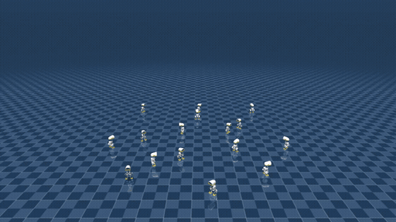
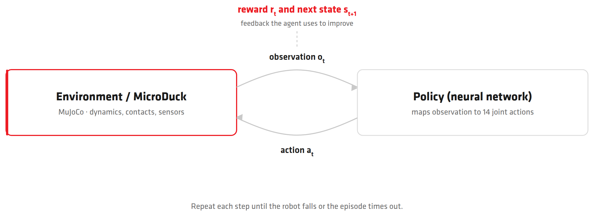
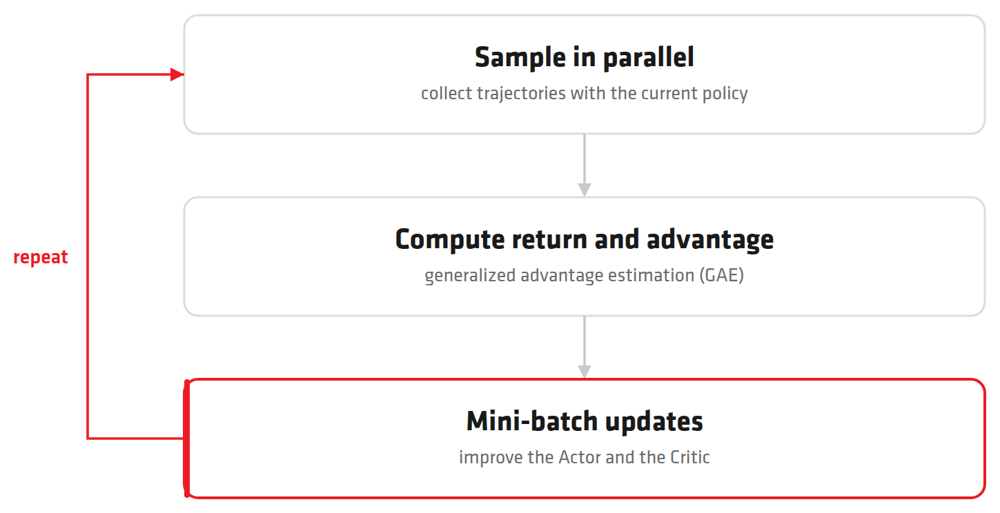
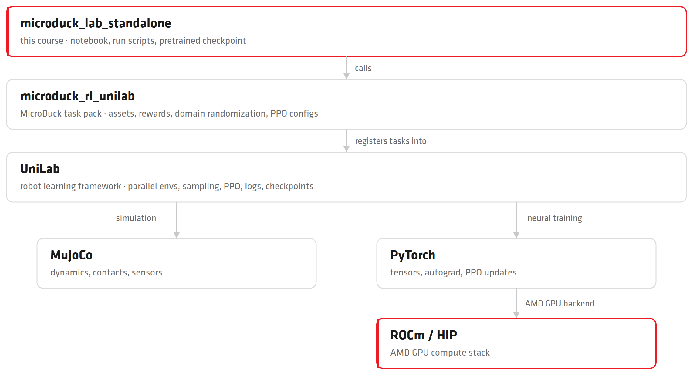

<!--
Copyright Advanced Micro Devices, Inc.

SPDX-License-Identifier: MIT
-->

<!-- @github-only -->
> [!IMPORTANT]
> This playbook uses special tags that GitHub cannot render. Please visit [amd.com/playbooks](https://amd.com/playbooks) to correctly preview this content.
<!-- @github-only:end -->

## Overview

This playbook teaches omnidirectional velocity tracking for the [MicroDuck](https://github.com/pollen-robotics/microduck) robot with proximal policy optimization (PPO) on AMD ROCm™ software. You train a walking policy in simulation, watch it move, and compare that early policy with a longer-trained reference checkpoint.

It does not assume a reinforcement learning or robotics background. The ideas are explained in [Background knowledge](#background-knowledge) and again against the MicroDuck task.

How do you give MicroDuck a desired velocity and direction and let it decide how all 14 joints should move at each moment? For example, given "0.3 m/s forward, 0.1 m/s left, while turning counterclockwise," it should:

- Track forward/back, left/right, and yaw commands as accurately as possible.
- Stay upright, with as few falls and as little slipping as possible.
- Produce continuous, natural gaits without frequent self-collisions or joint-limit hits.
- Keep walking despite sensor noise, actuation delay, mass variation, and external pushes.

Hand-writing control rules that cover every velocity combination for 14 joints is hard. Reinforcement learning lets the robot try actions in simulation, judge outcomes from reward, and gradually learn a control policy from observations to actions.

The clip below is a fully trained policy: the robots stay upright and track their commanded velocity with a continuous gait. You will render a policy like this in [Phase 2](#phase-2-the-pretrained-reference-demo).



[Download a higher-quality version of the preview video.](https://raw.githubusercontent.com/rocPAI-Forge/microduck_rl_tutorial/0e515b775273f96af4b45b5eed0db886880d6ccc/notebooks/assets/_phase2.mp4)

## What You'll Learn

- How an MDP maps onto a 14-joint walking task: state, action, reward, and episode
- Why PPO fits continuous joint control and many parallel simulations
- How reward terms, domain randomization, and curriculum change what the robot learns
- How to train a MicroDuck policy from scratch on ROCm and read reward, episode length, and replay video
- How to tell a short student run apart from a larger reference checkpoint without mixing their metrics

## Prerequisites

### Hardware

Run this playbook on Linux with one of these AMD GPUs. Both were used to verify the tutorial this playbook is built from.

| Playbook device | Product | Architecture |
|---|---|---|
| `r9700` | AMD Radeon™ 9000 Series Graphics (AI Pro R9700) | `gfx1201` |
| `halo` | AMD Ryzen™ AI Max+ (Strix Halo) | `gfx1151` |
| `w7900` | AMD Radeon™ PRO W7900 | `gfx1100` |

Phase 1 launches 500 simulations at once. If the run runs out of memory, lower `algo.num_envs` and keep the same task. Confirm the smaller setting with the smoke test before starting the long run.

### Software

**ROCm PyTorch container.** The lab was verified in this image, which already includes HIP-enabled PyTorch 2.10.0:

`rocm/pytorch:rocm7.2.4_ubuntu24.04_py3.12_pytorch_release_2.10.0`

**Docker.** Install Docker and confirm it can see the GPU. Skip the install steps if this container is already running. To use Docker without root:

```bash
sudo usermod -aG docker $USER
newgrp docker
```

Confirm Docker itself starts:

```bash
docker run hello-world
```

The setup script then checks out two pinned repositories:

| Repository | Commit | What it provides |
|---|---|---|
| [`microduck_rl_unilab`](https://github.com/rocPAI-Forge/microduck_rl_unilab) | `20fb528fa6c4a9559155b33e5304568668c7b7e2` | Robot, rewards, task config, and the `microduck-train` command |
| [`microduck_rl_tutorial`](https://github.com/rocPAI-Forge/microduck_rl_tutorial) | `0e515b775273f96af4b45b5eed0db886880d6ccc` | Training wrapper, environment check, and `model_950.pt` |

## Learning path

Read [Background knowledge](#background-knowledge) first, then run the commands in order. A long training command can sit without printing while the GPU is busy. Wait for it to finish before the next command.

| Phase | Config | What you do |
|---|---|---|
| [Environment setup](#getting-started) | ROCm container and lab workspace | Start the container, check the GPU, install the lab |
| [Smoke test](#smoke-test-4-env--2-iter) | 4 env × 2 iter | Confirm the stack runs and read a raw training log |
| [1](#phase-1-train-from-scratch-500-env--300-iter) | 500 env × 300 iter | Train from scratch and render a 10-second replay |
| [2](#phase-2-the-pretrained-reference-demo) | Provided reference checkpoint | Replay `model_950.pt` |
| [3](#phase-3-how-do-you-tell-if-the-policy-got-better) | Compare | Compare reward, episode length, curves, and video |

## Background knowledge

Before training, it helps to know what the commands are changing.

### Reinforcement learning and MDPs

#### What is reinforcement learning?

Reinforcement learning (RL) is a machine learning approach in which an agent takes actions in an environment and uses feedback to improve long-term behavior. Unlike supervised learning, this robot is not told the correct 14-joint action for each state. It receives rewards and learns better action sequences by trial and error.



#### Why train robots with RL in simulation?

- Joints are strongly coupled. One action continues to affect later states.
- There is more than one goal. Speed, balance, smoothness, energy, and safety trade off against each other.
- Simulation can generate millions of interactions in parallel, far more cheaply than hardware trial and error.
- A neural policy can learn nonlinear feedback that is hard to write by hand.

> **Note:** RL is not a magic bullet. A poorly designed reward can be exploited, simulated behavior might not transfer to real hardware, and training is stochastic. Replay, metrics, domain randomization, and eventual on-robot safety checks sit alongside the training run.

#### What is an MDP?

RL is usually formulated as a Markov Decision Process (MDP). An MDP is often written `(S, A, P, R, γ)`:

| Symbol | Meaning | MicroDuck example |
|---|---|---|
| `S` state | True situation of the world | Pose, joints, velocities, contacts |
| `A` action | Decision the agent can make | 14-D joint targets |
| `P` transition | How an action leads to the next state | MuJoCo dynamics, contacts, actuator model |
| `R` reward | How good the current outcome is | Sum of tracking, upright, gait, and penalty terms |
| `γ` discount | How much future reward is valued | Closer to 1 means more long-horizon stability |

> **Note:** Given the current state and action, predicting the next step does not require the full history. A real robot usually sees noisy, delayed, incomplete observations `o_t`, so the code distinguishes state from observation.

#### Mapping the MDP onto this task

- **Command:** periodically sample `twist = (vx, vy, yaw_rate)`. Ranges are about ±0.4 m/s forward/back, ±0.3 m/s lateral, and ±1.0 rad/s yaw.
- **Observation:** body angular velocity, gravity direction, joint position and velocity, last action, velocity command, head command, and other terms. The actor uses a 61-D deployable observation.
- **Action:** every 20 ms the policy outputs 14-D joint targets. A better actuator model (BAM) voltage servo turns them into actuator effort.
- **Rates:** physics at 200 Hz (`sim_dt=0.005 s`), policy at 50 Hz (`ctrl_dt=0.02 s`).
- **Episode:** at most 20 s, which is 1000 control steps. Tilt beyond about 70°, NaNs, or timeout ends the episode.
- **Policy:** a neural net `πθ(a|o)` with parameters `θ`. A finished `model_*.pt` stores the learned parameters.

### From common RL algorithms to PPO

| Family | Examples | Idea | Typical traits |
|---|---|---|---|
| Value-based | Deep Q-Network (DQN) | Learn action values, then pick the highest | Classic DQN fits discrete actions, not 14-D continuous joints |
| Policy gradient | REINFORCE | Directly raise the probability of high-return actions | Simple, but high-variance and sample-inefficient |
| Actor-Critic | A2C and A3C | Actor chooses actions; critic evaluates states and actions | Learns policy and value together; lowers policy-gradient variance |
| On-policy actor-critic | **PPO** | Train on data just collected by the current policy, with a limited update size | Stable, mature implementations, scales to many parallel envs |
| Off-policy actor-critic | Soft Actor-Critic (SAC), Twin Delayed DDPG (TD3) | Reuse experience from a replay buffer | High sample reuse for continuous control; different tuning cost at large scale |

On-policy means training mainly uses data from the current policy. Off-policy algorithms can reuse data collected by an older policy. No algorithm is best for every task.

#### Why PPO for MicroDuck

MicroDuck has 14-D continuous actions, and simulation can run hundreds to thousands of environments at once.

1. **Fits continuous control.** The policy can output a continuous distribution per joint.
2. **More stable updates.** The PPO clip limits how far the new policy may move, so one update is less likely to destroy a learned gait.
3. **Parallel sampling.** 500 or 2048 environments make a large on-policy batch.
4. **Mature locomotion recipes.** Many verified PPO setups exist for robot walking.
5. **Actor-critic structure.** The actor learns actions. The critic estimates future return, so you can tell whether an action was better than expected.

PPO does not simply pick the max-reward action. It loops: sample, score, update, repeat.



PPO in this lab uses these quantities:

- **Return:** discounted reward accumulated from the current time.
- **Value:** the critic's prediction of future return.
- **Advantage:** how much better the outcome was than the critic expected.
- **PPO clip:** if the new policy changes too much versus the old one, truncate that optimization gain.
- **Entropy:** keep some exploration so the policy does not become fully deterministic too early.

This task uses an **asymmetric actor-critic**. The actor sees only the deployable 61-D noisy observation. During training the critic also sees foot contacts, foot height, and body linear velocity (76-D total). Extra information helps the critic judge the rollout. Deployment does not need those privileged observations.

<details>
<summary><strong>Advanced:</strong> PPO hyperparameters used here</summary>

- Actor/Critic multilayer perceptron (MLP): `[512, 256, 128]`, exponential linear unit (ELU)
- PPO clip: `0.2`; discount `gamma=0.99`; GAE `lambda=0.95`
- 5 epochs per batch, split into 4 mini-batches
- Initial action-noise std `1.0`, entropy coefficient `0.01`
- Adaptive learning rate, target KL divergence `0.01`
- Left-right symmetric mirror loss, coefficient `0.5`

Together these affect update stability, exploration, and compute. Do not change many of them in one experiment.

</details>

#### What one iteration does

1. Each parallel environment runs the current policy for **24 control steps**.
2. Record `(observation, action, reward, terminated, value estimate)`.
3. Gather all transitions. In Phase 1 that is `500 × 24 = 12,000` per round.
4. Compute advantage and update the actor and critic on the GPU.
5. Write logs, save a checkpoint if needed, then start the next round.

Training and evaluation use Hydra parameters:

| Hydra parameter | Meaning |
|---|---|
| `algo.num_envs` | Independent simulations running at once |
| `algo.max_iterations` | How many sample-and-update loops |
| `algo.save_interval` | Save a checkpoint every N iterations |
| `training.no_play=true` | Do not auto-replay after training |
| `training.play_steps` | How many 50 Hz control steps to run at eval |
| `training.log_root` | Root directory for logs and checkpoints |

### Reward, domain randomization, and curriculum

#### What the reward is measuring

A reward function turns "how the robot should behave" into a scalar at every step. The policy maximizes long-horizon return:

`total reward = task reward + posture/gait reward − cost of unsafe or jerky behavior`

Reward is not a human demonstration and not a success rate. A value of 94 does not mean 94% correct. Values are comparable only under the same task and the same reward definition.

Omnidirectional walking cannot reward forward speed alone, or the robot could score by falling and sliding. This task uses several terms at once:

| Design goal | Representative term | Weight direction | What it prevents |
|---|---|---|---|
| Track planar velocity | `tracking_lin_vel` | `+2.0` | Ignoring `(vx, vy)`, or tracking only one direction |
| Track yaw rate | `tracking_ang_vel` | `+2.0` | Not turning with the yaw command |
| Stay upright | `upright` | `+2.0` | Tilting or lying down to farm speed |
| Track head pose | `head_pose_tracking` | `+2.0` | Walking while the head is uncontrolled |
| Reasonable leg pose | `leg_pose` | `+1.0` | Bizarre joint configurations |
| Reasonable air time | `air_time` | `+3.0` | Dragging feet, or no real gait |
| Foot height / slip | `foot_clearance -2.0`, `foot_swing_height -0.25`, `foot_slip -0.1` | penalty | Swing that is too high or too low, sliding on contact |
| Safety and smoothness | self-collision `-1.0`, joint limits `-1.0`, action change `-0.1` | penalty | Hitting itself, slamming limits, jitter |
| Body stability | body angular velocity `-0.05`, angular momentum `-0.02` | penalty | Violent upper-body motion |

Too much tracking can yield a brutal gait. Too much smoothness can make the robot refuse to move. Read total reward, per-term rewards, episode length, and the replay together.

#### Domain randomization

Mass, friction, sensors, and actuators in simulation are more ideal than on hardware. Domain randomization changes those conditions per environment during training so the policy works for a family of worlds, not one exact parameter set.

This task randomizes:

- Observation noise and inertial measurement unit (IMU) bias
- About 20 ms of joint-velocity delay
- Battery voltage, load sag, command delay, and actuator friction
- Robot mass and inertia, center of mass (CoM), joint initialization, and foot friction
- Random pushes every 3–6 s, so the policy practices recovery

The goal is robustness and a smaller sim-to-real gap. It does not erase model error, and it does not replace hardware tests, action limits, or an emergency stop.

<details>
<summary><strong>Advanced:</strong> Domain randomization versus curriculum</summary>

- **Domain randomization** answers "what random world is each environment?"
- **Curriculum learning** answers "when does difficulty increase?"

This task gradually strengthens action-change penalties, widens head-command and CoM randomization, and raises the fraction of stand-still commands. Curriculum advances by environment control steps. Because each PPO iteration rolls out 24 steps, `12000 steps` in the configuration is about `500 iterations`. Raising `num_envs` increases samples per round. It does not by itself advance one environment's curriculum.

</details>

## Getting Started

Clone this repository and work from the playbook directory. Later commands run inside the container, with the working directory set to `assets/`.

<!-- @os:linux -->

### Start the ROCm container

On the host, from `playbooks/supplemental/microduck-rl`:

```bash
docker pull rocm/pytorch:rocm7.2.4_ubuntu24.04_py3.12_pytorch_release_2.10.0
docker run --rm -it --name microduck-lab \
  --device=/dev/kfd --device=/dev/dri --group-add video \
  --ipc=host --shm-size=8g \
  -v "$PWD:/workspace/lab" \
  -w /workspace/lab/assets \
  rocm/pytorch:rocm7.2.4_ubuntu24.04_py3.12_pytorch_release_2.10.0 bash
```

The shell that opens is already in `/workspace/lab/assets`. Run every later command there.

This command uses `--rm`, so the container is deleted when you exit the shell. The playbook directory on the host keeps `assets/microduck_workspace/`, `assets/runs/`, and `assets/lab-env.sh`. Anything installed inside the container is deleted with it: the apt libraries below, and the Python packages `prepare_workspace.py` installs into `/opt/venv`.

Start the container again, then repeat the apt command and `python3 prepare_workspace.py` before `source lab-env.sh`. The script keeps the checkouts already on disk and reinstalls the Python packages. Do not skip apt. Rendering needs those libraries, and training needs the Python packages.

Inside the container, install the libraries MuJoCo uses to render off-screen, plus Git and a virtual environment:

```bash
apt-get update && apt-get install -y --no-install-recommends \
  git curl ca-certificates ffmpeg python3-venv \
  libosmesa6 libgl1 libgl1-mesa-dri libglfw3 libxcursor1 libxi6 libxinerama1
```

<!-- @test:id=install-lab-packages timeout=900 hidden=true -->
```bash
if [ "$(id -u)" -eq 0 ]; then
  apt-get update && apt-get install -y --no-install-recommends \
    git curl ca-certificates ffmpeg python3-venv \
    libosmesa6 libgl1 libgl1-mesa-dri libglfw3 libxcursor1 libxi6 libxinerama1
else
  sudo apt-get update && sudo apt-get install -y --no-install-recommends \
    git curl ca-certificates ffmpeg python3-venv \
    libosmesa6 libgl1 libgl1-mesa-dri libglfw3 libxcursor1 libxi6 libxinerama1
fi
```
<!-- @test:end -->

### Check the GPU

Confirm HIP is available and at least one GPU is visible before installing the lab.

<!-- @test:id=check-rocm timeout=180 -->
```bash
python3 check_rocm.py
```
<!-- @test:end -->

Expected result: the table shows a ROCm / HIP version and at least one GPU name. If HIP is unavailable, the container was started without `/dev/kfd` and `/dev/dri`.

### Prepare the workspace

[`prepare_workspace.py`](assets/prepare_workspace.py) checks out the two pinned repositories and installs UniLab, the MicroDuck task, and the plotting packages into the container's ROCm Python (`/opt/venv` in the image above). It does not reinstall PyTorch. Downloading packages can take several minutes.

<!-- @test:id=prepare-workspace timeout=2400 -->
```bash
python3 prepare_workspace.py
```
<!-- @test:end -->

<!-- @setup:id=lab-env command="source lab-env.sh" -->

The script writes `lab-env.sh`. Source it in every later shell so `microduck-train` and the task registry are on `PATH`:

```bash
source lab-env.sh
```

### How the pieces fit together



| Project | Repository | Role in this playbook |
|---|---|---|
| **UniLab** | [`Motphys/UniLab`](https://github.com/Motphys/UniLab) | Parallel environments, PPO, logging, checkpoints, and playback |
| **microduck_rl_unilab** | [`rocPAI-Forge/microduck_rl_unilab`](https://github.com/rocPAI-Forge/microduck_rl_unilab) | MicroDuck assets, actuator model, observations, rewards, commands, domain randomization, and `microduck_velocity_flat` |

Both projects use the Apache-2.0 license. UniLab is the generic training base. `microduck_rl_unilab` is this robot's task. `microduck_rl_tutorial` organizes the teaching assets and the reference checkpoint. It does not reimplement PPO.

A few roles that are easy to mix up:

- ROCm is not an RL framework. It lets PyTorch run on AMD GPUs.
- PyTorch does not contain the MicroDuck task. It runs the network and the optimizer.
- UniLab is not the robot model. It runs training and simulation.
- `microduck_rl_unilab` defines this robot, its rewards, and the task config.
- `--sim mujoco` means MuJoCo computes the robot dynamics. PyTorch on ROCm runs the policy and the PPO update.

| Component | Location inside the container |
|---|---|
| Playbook scripts | `/workspace/lab/assets` |
| ROCm Python | `/opt/venv` in the official image |
| MicroDuck task | `/workspace/lab/assets/microduck_workspace/microduck_rl_unilab` |
| Reference checkpoint and helper scripts | `/workspace/lab/assets/microduck_workspace/microduck_rl_tutorial` |
| Training and evaluation outputs | `/workspace/lab/assets/runs` |

### Two policies, two metrics

Phase 1 trains a student policy from scratch. Phase 2 loads a pretrained reference policy. Their scores use different measures.

| | Phase 1: your student run | Phase 2: provided reference |
|---|---|---|
| Checkpoint | `model_299.pt`, produced by this playbook | `model_950.pt`, from the pinned tutorial repository |
| Training budget | 500 env × 300 updates | 2048 env × 951 updates, including directional fine-tuning |
| Samples / iteration | 12,000 | 49,152 |
| Env steps at the checkpoint | about 3.6M | **46,743,552** |
| What is measured | PPO reward, episode length, and replay video | Fixed-command six-direction selection score **81.9 / 100** (seed 123) and replay video |

The `950` in `model_950.pt` is a zero-based checkpoint index. Updates 0 through 950 are **951 updates**. Each update gathers 24 steps in 2048 environments, so `2048 × 24 × 951 = 46,743,552` environment steps.

The policy interface is the same for both: actor observation **61-D**, critic observation **76-D**, action **14-D**. Raising `algo.num_envs` and `algo.max_iterations` on your own run shows what a larger sample budget does. Those two settings alone do not reproduce the reference recipe.

### Environment check

[`check_env.sh`](https://github.com/rocPAI-Forge/microduck_rl_tutorial/blob/0e515b775273f96af4b45b5eed0db886880d6ccc/scripts/check_env.sh) prints the Python, PyTorch, HIP, and package versions the lab will train with. Confirm HIP is present and `microduck_rl_unilab` is installed.

<!-- @test:id=check-env timeout=180 setup=lab-env -->
```bash
source lab-env.sh
bash "$LAB_ROOT/scripts/check_env.sh"
```
<!-- @test:end -->

## Smoke test (4 env × 2 iter)

The smoke test runs only 2 iterations. It checks ROCm PyTorch, task registration, the MuJoCo model, sampling, a PPO update, and checkpoint writes. It is too short to learn a gait. The full log stays on screen so the field names are visible.

Watch for:

- `Learning iteration 0/2`: the current training round
- `Mean reward`: average cumulative reward of recent episodes. A low number this early is normal.
- `Mean episode length`: average surviving control steps. A very short length usually means frequent falls.
- `Collection time` / `Learning time`: sampling versus the network update
- `ETA`: remaining time at the current pace

<!-- @test:id=smoke-train timeout=1200 setup=lab-env -->
```bash
source lab-env.sh
cd "$MICRODUCK_ROOT"
microduck-train --algo ppo --task microduck_velocity_flat --sim mujoco \
  algo.num_envs=4 algo.max_iterations=2 training.no_play=true \
  training.logger=tensorboard training.log_root="$LAB_LOG_ROOT"
```
<!-- @test:end -->

Success looks like iteration `1/2` finishing, an `ETA` of `0:00:00`, and a new run directory under `assets/runs/MicroduckVelocityFlat/`.

## Phase 1 Train from scratch (500 env × 300 iter)

Complete one medium PPO run and look at a policy that is learning and not finished.

| Parameter | Value | What it means |
|---|---|---|
| `algo.num_envs` | 500 | 500 independent MicroDuck simulations at once |
| `algo.max_iterations` | 300 | 300 rounds of "sample 24 steps, then update the network" |
| `algo.save_interval` | 50 | Save every 50 iterations so a crash does not wipe the run |
| `LAB_LOG_EVERY` | 10 | Print a one-line summary every 10 iterations |

The full log goes to `assets/runs/logs/phase1_500x300.log`. Watch the trend of reward and episode length. These metrics do not rise on every line. Training is finished when the log reaches the planned iteration and `ETA` is `0:00:00`.

```bash
source lab-env.sh
export LAB_TRAIN_LOG="${LAB_LOG_ROOT}/logs/phase1_500x300.log"
export LAB_LOG_EVERY=10
bash "${LAB_ROOT}/scripts/run_train.sh" \
  --algo ppo --task microduck_velocity_flat --sim mujoco \
  algo.num_envs=500 algo.max_iterations=300 algo.save_interval=50 \
  training.no_play=true training.logger=tensorboard training.log_root="${LAB_LOG_ROOT}"
```

### How to read the one-line log

A sample line:

```text
[train] iter  299/300 | reward    4.59 | ep  78.59 |  0:03:59 | ETA  0:00:00 | 0.80s/iter
```

| Field | Meaning | How to read this example |
|---|---|---|
| `iter 299/300` | PPO iterations are 0-indexed. `299` is the 300th sample and update | The planned 300 iterations finished |
| `reward 4.59` | Mean cumulative reward of recently finished episodes | Compare only with the same task and reward |
| `ep 78.59` | Mean episode length in control steps | At 50 Hz this is `78.59 / 50 ≈ 1.57 s`, so episodes still end early |
| `0:03:59` | Elapsed time printed by the trainer | Progress of this run, not a hardware score |
| `ETA 0:00:00` | Remaining time at the recent pace | The run is done |
| `0.80s/iter` | Average time per PPO iteration | A trainer counter, not a policy-quality score |

The elapsed time in that sample was measured on a much larger GPU. Your AI Pro R9700 or Ryzen AI Max+ run will take longer. Read your own reward and episode length.

#### A rising reward is not enough

A rising long-term trend is a good sign. One bump, or a short noisy stretch, does not prove the policy improved. PPO samples randomly, so reward is not monotonic. It can also dip when the curriculum gets harder, or look high because of reward hacking.

Judge the run with all three:

- **Reward trend** over tens of iterations, not the last point
- **Episode length**, and whether it moves toward the 1000-step cap (about 20 s)
- **Eval video**: upright, tracking commands, without obvious slip, jitter, or heading error

In the example, `reward=4.59` and `ep=78.59` mean the 300-iteration policy learned something, and episodes still end after about 1.57 s. Use your own numbers and your own replay. The reference policy in Phase 2 is there so you can see a stronger gait.

> Quick check: if the next run reports `ep=750`, convert that to seconds first (`750 / 50 = 15 s`), then use the reward curve and the video to decide whether tracking actually improved.

### Render a 10-second replay

Training explores and updates parameters. Eval loads a checkpoint, runs the policy, and writes a video. It does not learn.

Rendering uses OSMesa on the CPU. GPU utilization can sit at 0 while the video is being written. Wait until the script prints the video path.

| Parameter | Meaning |
|---|---|
| `--load-run -1` | Latest training run for this task |
| `training.play_steps=500` | 50 Hz, so `500 × 0.02 s = 10 s` of replay |
| `training.play_env_num=1` | One robot, in a close-up view |
| `training.cam_distance=0.9`, `training.cam_tracking=true` | Keep the robot large and centered |

[`eval_phase1.py`](assets/eval_phase1.py) writes `play_video.mp4` under the run directory. The training summary covers every environment. This clip is one sampled environment, so you can see posture, gait, foot slip, and falls.

```bash
source lab-env.sh
python3 eval_phase1.py
```

Play the replay on the host, not inside the container. The container has no display. From the playbook directory on the host, use either command.

`ffplay` is the same player on every machine. Press `q` to close the window. It comes with the `ffmpeg` package. If the command is missing, run `sudo apt install ffmpeg`.

`xdg-open` hands the file to the desktop's default application, so the player can differ between machines. The command returns immediately and leaves that window open. It comes with the `xdg-utils` package.

```bash
RUN_DIR=$(ls -td assets/runs/MicroduckVelocityFlat/*_mujoco | head -1)
ls -lh "$RUN_DIR/play_video.mp4"
ffplay -loglevel error "$RUN_DIR/play_video.mp4"
```

```bash
RUN_DIR=$(ls -td assets/runs/MicroduckVelocityFlat/*_mujoco | head -1)
xdg-open "$RUN_DIR/play_video.mp4"
```

Then print the checkpoint metrics:

```bash
source lab-env.sh
python3 read_phase1_summary.py
```

### How to read that replay

The video follows one environment using your 300-iteration policy. Its initial state and velocity command are sampled by the task. The robot may fall, reset, and receive another command during the 10 seconds.

Separate two cases:

- If the target speed is near 0, standing or balancing in place can be the correct response.
- If there is a clear motion command and the robot stays still, only steps in place, or falls quickly, the policy has not yet formed a reliable gait.

Ten seconds is the length of the clip, not the lifetime of each episode. Robots may reset several times inside the video. A 300-iteration policy is not always weak. Use the reward, episode length, and replay from your own run.

## Phase 2 The pretrained reference demo

Load the selected reference checkpoint and watch a policy that had a much larger training budget.

- The checkpoint is `examples/velocity_flat_demo/model_950.pt` inside the pinned tutorial checkout.
- It used 2048 parallel environments and 46,743,552 environment steps, including directional fine-tuning.
- Selection used 32 trials × 10 s of fixed commands. Forward, back, left, and right passed. Yaw improved and is still the weak direction.
- The recipe and the six-direction numbers are in `run_summary.json` and `cardinal_eval*.json` next to the checkpoint.

| Reference metric | Value | How to read it |
|---|---|---|
| Linear directions | 4 / 4 passed | Stability, sign, error, and cross-axis drift together |
| seed-123 mean score | about 81.9 / 100 | Six-direction composite, not PPO reward |
| seed-123 worst direction | about 59.4 / 100 | The current bottleneck is yaw |
| Yaw survival | 100% | No fall in 10 s. This does not mean the yaw rate is accurate |
| Checkpoint | `model_950.pt` | Chosen by a checkpoint sweep, not "the last file saved" |

### Read the reference summary

[`read_reference_summary.py`](assets/read_reference_summary.py) prints the selection record. The score is out of 100. It is not the PPO reward from Phase 1, and the two numbers are not on the same scale.

<!-- @test:id=read-reference timeout=120 setup=lab-env -->
```bash
source lab-env.sh
python3 read_reference_summary.py
```
<!-- @test:end -->

### Render the reference policy

[`eval_reference.py`](assets/eval_reference.py) loads `model_950.pt` and renders 16 simulations. Each robot uses the same policy and its own sampled forward, lateral, and yaw command. The clip shows a variety of behavior. It does not guarantee that every direction appears.

| Parameter | Meaning |
|---|---|
| `--load-run examples/velocity_flat_demo` | The provided reference checkpoint |
| `training.play_steps=200` | 50 Hz, so `200 × 0.02 s = 4 s` |
| `training.play_env_num=16` | 16 robots, each with its own command |
| Default overview camera | The whole group. Each robot looks smaller than in the Phase 1 close-up |

Frames are rendered on the CPU. The script can take a few minutes, with little GPU activity, until it prints the video path.

<!-- @test:id=eval-reference timeout=1800 setup=lab-env -->
```bash
source lab-env.sh
python3 eval_reference.py
```
<!-- @test:end -->

Open the printed `play_video.mp4`. Compare it with the Phase 1 close-up: upright posture, whether the commanded direction shows up in the motion, and whether feet slip or the gait jitters.

On the host, from the playbook directory, use either command. Press `q` to close `ffplay`. The difference between the two commands is described with the Phase 1 replay.

```bash
ls -lh assets/microduck_workspace/microduck_rl_tutorial/examples/velocity_flat_demo/play_video.mp4
ffplay -loglevel error assets/microduck_workspace/microduck_rl_tutorial/examples/velocity_flat_demo/play_video.mp4
```

```bash
xdg-open assets/microduck_workspace/microduck_rl_tutorial/examples/velocity_flat_demo/play_video.mp4
```

<!-- @os:end -->

## Phase 3 How do you tell if the policy got better?

Do not conclude from a single reward number. Compare Phase 1 and Phase 2 in this order:

1. **Episode length first.** The maximum is 1000 steps, about 20 s. Short episodes usually mean falls.
2. **Replay video.** Upright, following the commanded velocity, without obvious slipping, jitter, or a one-sided gait.
3. **Reward curve.** A long-term rise, large oscillations, or a regression. Noise is normal.
4. **Training scale.** Phase 1 is about 3.6M environment steps. `model_950.pt` is 46.7M steps over 951 updates. Both the environment count and the iteration count changed, so this is overall scale, not a clean experiment on either knob.

| Dimension | Phase 1 student `model_299.pt` | Phase 2 reference `model_950.pt` |
|---|---|---|
| Source | Trained in this playbook | Pinned upstream checkpoint |
| Parallel environments | 500 | 2048 |
| Training updates | 300 | 951, including directional fine-tuning |
| Env steps | about 3.6M | 46,743,552 |
| Behavior | Early policy. Use your own video | Four linear directions pass the fixed-command gate |
| Metric | PPO reward and episode length | Six-direction score about 81.9/100, not PPO reward |

[`compare_runs.py`](assets/compare_runs.py) prints those two records and saves the Phase 1 reward and episode-length curves to `assets/runs/phase1_curves.png`. Run it after Phase 1.

```bash
source lab-env.sh
python3 compare_runs.py
```

On the host, from the playbook directory, open the saved curves with either command. Press `q` to close `ffplay`.

```bash
ls -lh assets/runs/phase1_curves.png
ffplay -loglevel error assets/runs/phase1_curves.png
```

```bash
xdg-open assets/runs/phase1_curves.png
```

If the file is missing, run `compare_runs.py` again inside the container after Phase 1 has finished.

### Reflection questions

1. Does a longer episode length always mean more accurate velocity tracking? Why?
2. If you only increase the survival reward, what cheating behavior might the robot learn?
3. Phase 2 uses more parallel environments than Phase 1. Why is a higher `num_envs` not, by itself, evidence that the gait is better?
4. To compare `num_envs` rigorously, what would you hold constant, and how would you use seeds?
5. Which video symptoms might point at the reward or the domain-randomization config?

<details>
<summary>Answers. Think first, then open this.</summary>

**1. Does a longer episode always mean better tracking?**

No. It means the robot lasted longer before termination. It might stand still or take tiny steps to avoid falling. Check the velocity-tracking term, episode length, and the eval video together.

**2. What cheating behavior can a survival-only reward produce?**

The policy may freeze, crouch, stand stiffly, or keep tiny steps, because those behaviors survive without walking. That is reward hacking: optimizing the specified score rather than the intended behavior.

**3. Why is a higher `num_envs` not a gait score?**

It only changes how many transitions each update sees. Gait quality still has to be read from the reward terms, episode length, and the video.

**4. How do you compare `num_envs` fairly?**

Fix the task config, network, PPO hyperparameters, hardware, and total environment steps. When you raise `num_envs`, lower the iteration count so both groups see the same sample budget. Use the same seeds, report mean and spread, and compare reward, episode length, and video.

**5. Which video symptoms suggest a config issue?**

- A persistent lean to one side: symmetry, command tracking, or randomization may be weak.
- Obvious foot slip: the foot-slip penalty, friction, or contact model may be off.
- High-frequency jitter: the action-smoothness penalty is weak, or delay and noise coverage is thin.
- Only standing: survival reward is too strong relative to the task reward.
- Falls right after command changes: the curriculum ramped too fast, or command coverage is narrow.
- Tiny simulation changes break it: randomization is too narrow. If training never settles, the range may be too wide.

These are hypotheses. Check per-term rewards and repeat the eval before changing the config.

</details>

## Summary

You trained a MicroDuck walking policy from scratch with PPO, judged it with metrics and a replay, and compared it with a reference policy trained at a larger scale.

- RL learns a control policy from simulated trial and error. It does not need a labeled joint action for every state.
- PPO is an actor-critic method with a limited update size. It fits continuous actions and large parallel sampling. It is not the right tool for every task.
- The reward defines what "good" means. It has to cover the task, stability, gait, safety, and smoothness, and you have to watch for reward hacking.
- `num_envs` sets how much data each round collects. `max_iterations` sets how many sample-and-update loops run. Training scale is not either number alone.
- Domain randomization and curriculum are different. One varies the world. The other changes difficulty over time.
- A stable simulation gait still needs action limits, fall protection, and an emergency stop before it goes on a real robot.

### Check your understanding

1. What does the 4-environment, 2-iteration smoke test verify?
2. What do `num_envs=500` and `max_iterations=300` control in Phase 1?
3. At 50 Hz, how long is an evaluation with `play_steps=500`?
4. Why does Phase 2 load `model_950.pt` instead of training that checkpoint here?

<details>
<summary>Answers</summary>

1. It checks ROCm, task registration, MuJoCo, a PPO update, and checkpoint writing. It is too short to learn a stable gait.
2. They set 500 parallel simulations and 300 rollout-and-update rounds.
3. `500 × 0.02 s = 10 s` of replay. An individual episode may end and reset sooner.
4. The reference model used a larger sample budget and directional fine-tuning. Loading it lets you compare behavior within this playbook instead of repeating that whole run.

</details>

## Next steps

`microduck_velocity_flat` is omnidirectional velocity tracking. The same checkout includes other tasks:

| Task | What it trains |
|---|---|
| `microduck_velocity_flat` | This playbook: forward, lateral, and yaw velocity |
| `microduck_sprint_flat` | Mostly forward walking, with narrower lateral and yaw commands |
| `microduck_velstand_flat` | Walking, plus recovery after a fall |
| `microduck_standup_flat` | Rising from sit, prone, and supine, then body-pose tracking |

The [task-pack README](https://github.com/rocPAI-Forge/microduck_rl_unilab#readme) lists the rest. Velocity commands, rewards, and curriculum for each task live in:

`assets/microduck_workspace/microduck_rl_unilab/src/microduck_rl_unilab/conf/ppo/task/<task>/base.yaml`

Change one thing at a time, then compare with the run from this playbook:

- `lin_vel_x`, `lin_vel_y`, and `ang_vel_z` under `commands.twist.ranges`
- One `weight` under `reward`
- One range in domain randomization or the curriculum

Confirm the new config with the same 4 × 2 smoke test before raising `num_envs` and `max_iterations`. Repeat with more than one seed. A stable simulation gait still needs action limits, fall protection, and an emergency stop before a real robot.

## Troubleshooting

| Symptom | What to do |
|---|---|
| The training command is quiet for a long time | Check that a new directory appeared under `assets/runs/`. Inside the container, run `rocm-smi` to confirm the GPU is busy |
| Eval finishes with no `play_video.mp4` | Confirm `--load-run` points at a directory that contains `model_*.pt`, then rerun the eval script |
| `HIP not available` or no GPU in `check_rocm.py` | Restart the container with `--device=/dev/kfd --device=/dev/dri --group-add video` |
| `No module named 'unilab'`, or `ffmpeg` is missing, after you start a new container | The previous container was removed by `--rm`. Run the apt command and `python3 prepare_workspace.py` again, then `source lab-env.sh` |
| `microduck-train: command not found` | `source lab-env.sh` in this shell. The file is created by `prepare_workspace.py` |
| Phase 1 runs out of memory | Lower `algo.num_envs`, rerun the smoke test, then start Phase 1 again |
| Reference summary script cannot find `run_summary.json` | Run `prepare_workspace.py` again. The reference files come from the pinned tutorial checkout |

## Glossary

| Term | Meaning in this playbook |
|---|---|
| Agent | The learner. Here, the policy network |
| Environment | The simulated world that takes an action and returns the next observation and reward |
| Observation | What the policy can read. It can be noisy, delayed, and incomplete |
| Action | Commands sent to the controller. Here, the 14-D joint targets |
| Policy / actor | Maps observations to actions |
| Critic / value | Predicts future return so the actor can learn |
| Reward | Immediate feedback each step. Not a success rate |
| Return | Discounted cumulative reward from a given step |
| Episode | One interaction from reset until a fall or a timeout |
| Rollout | A stretch of transitions collected with the current policy |
| Transition | One `(observation, action, reward, next observation, done)` record |
| Iteration | One round of rollout sampling plus a PPO update |
| Checkpoint | Saved model parameters from training |
| Domain randomization | Randomize simulation conditions so the policy is less brittle |
| Curriculum | Change task or randomization difficulty over training |
| Sim-to-real | Move a policy learned in simulation onto a real robot |

<details>
<summary>More ideas to explore</summary>

- **GAE.** Estimate advantage from multi-step rewards and the critic, trading bias against variance.
- **PPO clip.** Limit the gain from the new-policy / old-policy probability ratio so one update cannot jump too far.
- **Mirror loss.** Use left-right symmetry so the gait does not favor one side.
- **Curriculum.** Change reward weights, command ranges, or randomization over training, instead of enabling every randomization on day one.

</details>
