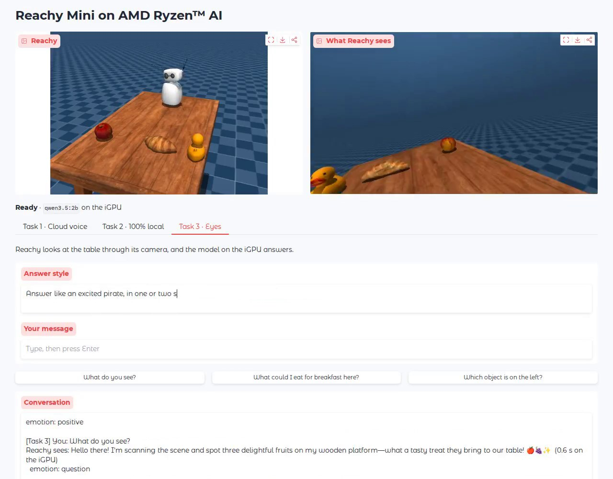
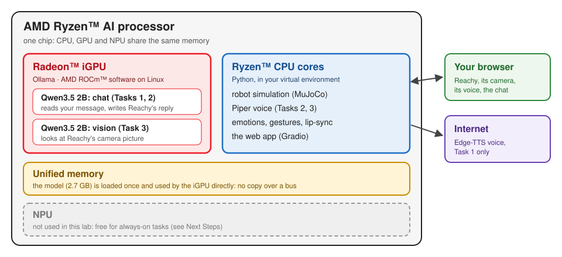

<!--
Copyright Advanced Micro Devices, Inc.

SPDX-License-Identifier: MIT
-->

<!-- @github-only -->
> [!IMPORTANT]
> This playbook uses special tags that GitHub cannot render. Please visit [amd.com/playbooks](https://amd.com/playbooks) to correctly preview this content.
<!-- @github-only:end -->

## Overview

An AMD Ryzen™ AI processor puts CPU cores, a Radeon™ GPU and an NPU on one chip, sharing the same memory. That is enough to give a robot a brain, a voice and eyes without sending anything to the cloud.

In this playbook you bring Reachy Mini, an expressive desktop robot from Pollen Robotics, to life. A language and vision model runs on the iGPU, a voice runs on the CPU, and Reachy nods, tilts its head and wiggles its antennas while it talks. **No robot is needed:** Reachy lives in the MuJoCo physics simulator, at a table with a duck, a croissant and an apple.

<p align="center">
  
</p>

## What You'll Learn

- How to run a language and vision model on the iGPU with Ollama
- How to write Python code that connects the model to a robot's voice, gestures and camera
- How to chat with the robot, and change its personality, in a Gradio UI

## Why run a robot's AI on your own computer?

- **Privacy:** what you say and what the robot sees never leave the machine
- **Low latency:** replies start in a fraction of a second, with no network round trip
- **Offline resilience:** the robot keeps working when the internet does not

<!-- @device:halo_box,halo,stx,krk -->
## Setting the Memory Configuration

<!-- @require:memory-config -->
<!-- @device:end -->

<!-- @device:halo_box -->
## Check for Software Updates

<!-- @require:software-update -->
<!-- @device:end -->

## Installing Software Prerequisites

<!-- @require = dependency docs rendered on the website; @prereq = CI-only, validated and auto-installed before tests (never rendered) -->
<!-- @require:driver -->
<!-- @prereq:ollama -->

### Install Ollama and the Model

<!-- @os:windows -->
Download the installer from [ollama.com/download](https://ollama.com/download) and run it. Ollama then runs in the background (look for its icon in the system tray).
<!-- @os:end -->

<!-- @os:linux -->
```bash
curl -fsSL https://ollama.com/install.sh | sh
```
<!-- @os:end -->

Download Qwen3.5 2B (2.7 GB), a model that understands both text and images:

<!-- @test:id=pull-model timeout=1800 -->
```bash
ollama pull qwen3.5:2b
```
<!-- @test:end -->

### Get the Lab Files

Download this playbook's `assets` folder with [Git](https://git-scm.com/downloads) and open a terminal in it:

```bash
git clone --depth 1 --filter=blob:none --sparse https://github.com/amd/playbooks.git
cd playbooks
git sparse-checkout set playbooks/supplemental/reachy-mini-teach-skills
cd playbooks/supplemental/reachy-mini-teach-skills/assets
```

### Create a Virtual Environment

<!-- @os:linux -->
On Linux, install the system packages the robot SDK needs, then create a venv:

<!-- @test:id=apt-packages timeout=600 -->
```bash
sudo apt update
sudo apt install -y python3-venv python3-dev pkg-config libcairo2-dev libgirepository1.0-dev \
  gir1.2-gst-plugins-base-1.0 gstreamer1.0-plugins-base gstreamer1.0-plugins-good libportaudio2 libegl1
```
<!-- @test:end -->

<!-- @test:id=create-venv timeout=120 -->
```bash
python3 -m venv reachy-env
source reachy-env/bin/activate
```
<!-- @test:end -->
<!-- @setup:id=activate-venv command="source reachy-env/bin/activate" -->
<!-- @os:end -->

<!-- @os:windows -->
On Windows, install Python 3.12 from [python.org](https://www.python.org/downloads/windows/) (tick **Add python.exe to PATH**), then create a venv:

<!-- @test:id=create-venv timeout=120 -->
```bash
python -m venv reachy-env
reachy-env\Scripts\activate
```
<!-- @test:end -->
<!-- @setup:id=activate-venv command="reachy-env\Scripts\activate" -->

> **Tip**: Windows users may need to modify their PowerShell Execution Policy (e.g.
> setting it to RemoteSigned or Unrestricted) before running some PowerShell commands.
<!-- @os:end -->

### Additional Dependencies

Install the Reachy Mini SDK with its simulator, the voices and Gradio, then download Reachy's local voice:

<!-- @test:id=install-deps timeout=1200 setup=activate-venv -->
```bash
pip install -r requirements.txt
python -m piper.download_voices en_US-joe-medium --data-dir models
```
<!-- @test:end -->

Every Python package the playbook uses is listed in [requirements.txt](assets/requirements.txt), with what it is for and its licence.

<!-- @test:id=verify-imports timeout=120 setup=activate-venv hidden=True -->
```python
import importlib, os, sys
sys.path.insert(0, os.getcwd())
for f in ["reachy_chat.py", "lab/emo_v1.py", "lab/emo_v2.py", "reachy_lab/app.py", "models/en_US-joe-medium.onnx"]:
    assert os.path.exists(f), f"FAIL: missing {f}"
for m in ["reachy_mini", "mujoco", "cv2", "gradio", "piper", "edge_tts", "reachy_chat", "reachy_lab.app"]:
    importlib.import_module(m)
print("PASS: files and imports")
```
<!-- @test:end -->

## Set up the Reachy Mini Demo

#### Learn About the Pipeline

Reachy Mini is open source: see the [Reachy Mini SDK](https://github.com/pollen-robotics/reachy_mini) from Pollen Robotics. Its brain here is [Qwen3.5 2B](https://ollama.com/library/qwen3.5), served by Ollama with AMD ROCm™ software on Linux. This is how the lab spreads the work across your processor:

<p align="center">
  
</p>

The model runs on the Radeon iGPU. The simulation, the Piper voice and the gestures run on the Ryzen CPU cores. Both share the same memory, so the model is never copied to a separate graphics card. The NPU is not used.

#### Lab Files

| File | Description | Usage |
|--------|-------------|-------|
| [reachy_chat.py](assets/reachy_chat.py) | The whole pipeline in one short script | `python reachy_chat.py` |
| [reachy_lab/](assets/reachy_lab) | The Gradio UI, built on `reachy_chat.py` | `python -m reachy_lab.app` |
| [reachy_lab/config.py](assets/reachy_lab/config.py) | Settings to try: personality, voice, model | edit, then rerun |
| [lab/](assets/lab) | Emotions, gestures and voices from the Reachy Mini lab by Thomas Zerbs | used by the scripts |

### Starting with reachy_chat.py

Run the script. It starts Reachy in the simulator, asks it a question, and lets it look at the table:

<!-- @test:id=reachy-chat timeout=900 setup=activate-venv -->
```bash
python reachy_chat.py
```
<!-- @test:end -->

You should see something like this (answers change from run to run):

```
You: Tell me a joke!
Reachy: Why don't robots ever tell jokes? Because they'd have to be programmed to do so by a human who is... not quite right for the role! 😂 What's your favorite kind of robot friend then?  (0.6 s on the iGPU)
🎙️ Loading Piper model: .../assets/models/en_US-joe-medium.onnx
✅ Piper TTS initialized
  (Reachy said 9.0 s of speech: reachy_says_001.wav)
  emotion: question
Reachy sees: Oh look at this adorable little rubber duck! It's so cute and bouncy. Plus, there's something yummy on the table too. Can't wait to explore more! 🐸🍞  (0.7 s on the iGPU)
  (Reachy said 8.1 s of speech: reachy_says_002.wav)
```

> **Note**: A 2B model is small and fast, and sometimes a little vague: here it saw the duck but not the croissant. Try `VISION_MODEL = "qwen3.5:4b"` in `reachy_lab/config.py` and compare.

Play the `reachy_says_*.wav` files to hear Reachy, and open `reachy_sees.jpg` to see what it saw. Ask your own question with `python reachy_chat.py "Who are you?"`.

> **Note**: The first run downloads Reachy's recorded emotions (about 20 MB). Check where the model ran with `ollama ps`: it should show **100% GPU**.

<!-- @test:id=reachy-chat-output timeout=60 hidden=True -->
```python
import glob, os
assert os.path.getsize("reachy_sees.jpg") > 0, "FAIL: reachy_sees.jpg was not created"
assert len(glob.glob("reachy_says_*.wav")) >= 2, "FAIL: Reachy did not speak twice"
print("PASS: Reachy answered, spoke and looked")
```
<!-- @test:end -->

#### Explaining the Code

**Snippet 1: Start Reachy in the simulator**

The simulator runs the same software as the real robot, so the rest of the code does not know the difference.

```python
def start_reachy(port=8765):
    daemon = SimDaemon(port).__enter__()
    mini = connect(port).__enter__()
    return daemon, mini, SimWorld(mini)
```

**Snippet 2: Ask the brain on the iGPU**

One HTTP request to Ollama. With an `image`, the same model answers questions about the picture.

```python
def ask(prompt, system=None, image=None, model=config.CHAT_MODEL, temperature=0.8):
    payload = {"model": model, "prompt": prompt, "think": False, "stream": False, "keep_alive": "30m",
               "options": {"temperature": temperature, "num_predict": 120, "num_ctx": 4096}}
    if system:
        payload["system"] = system
    if image is not None:  # an RGB picture: send it as JPEG, encoded in base64
        jpg = cv2.imencode(".jpg", image[:, :, ::-1])[1]
        payload["images"] = [base64.b64encode(jpg.tobytes()).decode()]
    request = urllib.request.Request(config.OLLAMA_URL + "/api/generate", data=json.dumps(payload).encode(),
                                     headers={"Content-Type": "application/json"})
    with urllib.request.urlopen(request, timeout=300) as r:
        return json.load(r)["response"].strip()
```

**Snippet 3: Choose a voice**

A local Piper voice runs on the CPU; an Edge voice comes from Microsoft's cloud.

```python
def voice(mini, piper_model=None, edge_voice=config.VOICE_1):
    if piper_model:
        from emo_v2 import EmotionControllerV71
        return EmotionControllerV71(mini, str(ASSETS / piper_model), piper_config=None, speaker_id=0, gentle_mode=True)
    from emo_v1 import EmotionControllerV6
    return EmotionControllerV6(mini, gentle_mode=True, voice=edge_voice)
```

**Snippet 4: Speak with feeling**

The text's mood picks the gestures, and Reachy moves while it speaks.

```python
def speak(controller, text):
    emotion, intensity, level = controller.analyze_emotion(text)
    controller.speak_with_expression(strip_emojis(text), emotion, intensity, level)
    return emotion
```

**Snippet 5: Look at the table**

Reachy tilts its head down, and its head camera takes the picture that goes to `ask(..., image=picture)`.

```python
def look_at_table(mini, world):
    mini.goto_target(head=create_head_pose(pitch=22, degrees=True), duration=0.8)
    return world.eye_frame(settle=1.0)
```

### Running the Gradio UI Demo

The UI builds on the same functions and lets you chat with Reachy while you watch it move and hear it speak.

```bash
python -m reachy_lab.app
```

Then open your web browser at `http://127.0.0.1:7860` and turn your sound on.

How to use the page:

1. **Watch Reachy.** The top-left picture is Reachy at its table; the top-right one is what its head camera sees. Both update live.
2. **Pick a task** from the three tabs.
3. **Talk to Reachy.** Click one of the example buttons, or type in **Your message** and press **Enter**.
4. **Wait for the answer.** The line under the pictures says *Reachy is thinking or talking ...*, then *Ready*. Reachy's words appear in **Conversation**, and its voice plays in **Reachy says**, which you can replay.
5. **Change Reachy.** Edit **Personality** or **Voice** (Tasks 1 and 2) or **Answer style** (Task 3). The change applies to your next message.

Each tab is one task:

| Tab | What happens | Try it |
|---|---|---|
| **Task 1 · Cloud voice** | The iGPU writes the reply; a Microsoft Edge voice says it | Click *Tell me a joke!*, then change the **Personality** to *"a grumpy pirate robot"* and click it again |
| **Task 2 · 100% local** | Same, with the Piper voice on the CPU | Turn off Wi-Fi and keep chatting: Reachy still answers |
| **Task 3 · Eyes** | Reachy looks at the table and answers about it | Ask *What could I eat for breakfast here?*, then set the **Answer style** to *"Answer like a pirate."* |

**Where is the model?** at the bottom of the page shows Ollama's report: 100% in GPU memory. Press **Ctrl+C** in the terminal to stop Reachy.

<!-- @test:id=app-selftest timeout=1200 setup=activate-venv hidden=True -->
```bash
python -m reachy_lab.app --selftest
```
<!-- @test:end -->

To keep your changes, edit the `>>> TRY ME <<<` settings in [reachy_lab/config.py](assets/reachy_lab/config.py).

> **Note**: Task 1 needs the internet. On a company network that inspects HTTPS, downloads may fail with `CERTIFICATE_VERIFY_FAILED`; `pip install pip-system-certs` lets Python trust your computer's certificates.

## Next Steps

- Give Reachy new moves: map an emotion to another of Pollen's recorded moves in `lab/emo_v1.py`.
- Put the NPU to work: add a microphone and a speech recognizer on the NPU with [Lemonade Server](https://lemonade-server.ai), and keep the iGPU for the language model.
- Drive a real Reachy Mini: the same SDK talks to the robot over USB.

## Resources

- [Reachy Mini SDK](https://github.com/pollen-robotics/reachy_mini) and its MuJoCo simulator, by Pollen Robotics (Apache-2.0)
- [Qwen3.5 on Ollama](https://ollama.com/library/qwen3.5) (Apache-2.0) and [Ollama](https://github.com/ollama/ollama) (MIT)
- [ROCm software](https://www.amd.com/en/products/software/rocm.html), the GPU compute stack under Ollama on Linux
- [Piper](https://github.com/OHF-Voice/piper1-gpl) (GPL-3.0) with the voice "Joe" (CC0), and [edge-tts](https://github.com/rany2/edge-tts) (LGPL-3.0)
- This playbook builds on the Reachy Mini lab by Thomas Zerbs for AMD Advancing AI 2026 (BSD-3-Clause)
