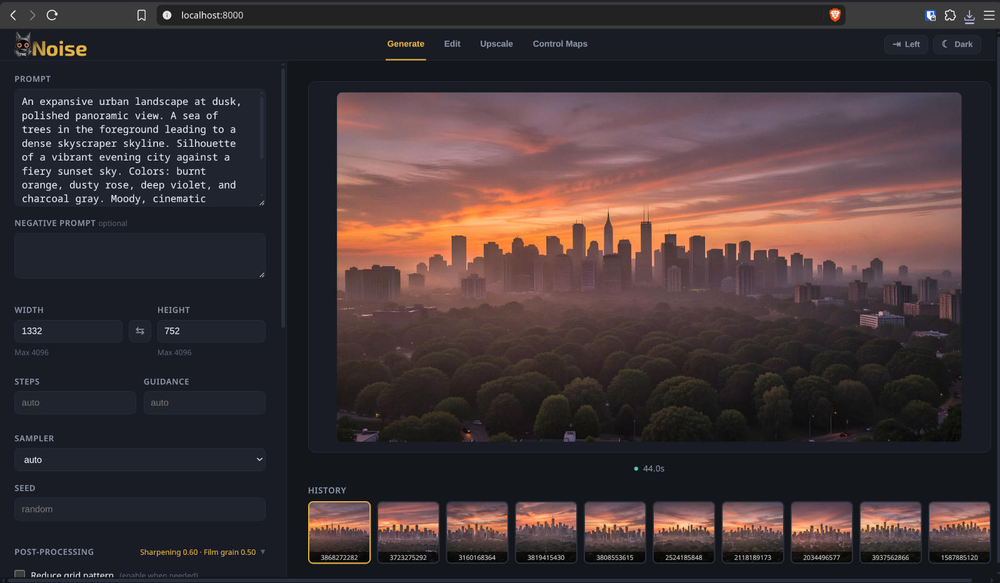
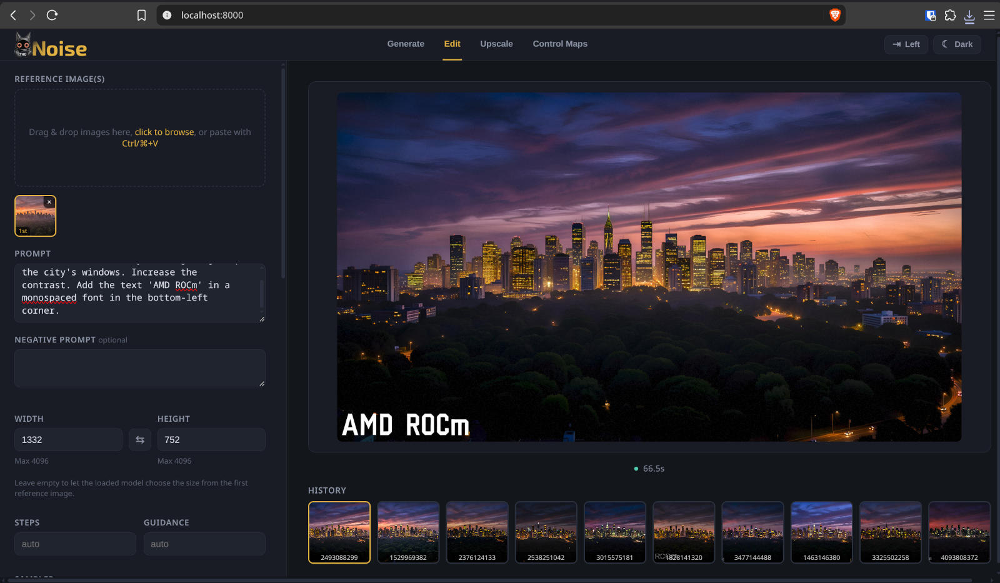

<!--
Copyright Advanced Micro Devices, Inc.

SPDX-License-Identifier: MIT
-->

<!-- @github-only -->
> [!IMPORTANT]
> This playbook uses special tags that GitHub cannot render. Please visit [amd.com/playbooks](https://amd.com/playbooks) to correctly preview this content.
<!-- @github-only:end -->

## Overview

TheNoise is a focused, open-source image generation and **editing** engine built on AMD ROCm™ software. It is tuned to run fast on AMD GPUs — from the Ryzen™ AI Halo platform to AMD Radeon™ discrete graphics.

This tutorial shows you how to edit images with TheNoise using the **Flux.2 Klein 4B** model — a distilled flow-matching model that generates in only **4 steps** and can also **edit** an existing image from a text instruction. You will generate a picture, then instruct the model to change it, all on your GPU.

## What You'll Learn

- How to install TheNoise and download the Flux.2 Klein 4B model
- The difference between image generation and image editing in a diffusion model
- How to edit an image from a text instruction with the `edit` command
- How to use the Web UI to edit interactively

<!-- @device:halo_box,halo,grgh,stx,krk -->
## Setting the Memory Configuration

<!-- @require:memory-config -->
<!-- @device:end -->

<!-- @device:halo_box -->
## Check for Software Updates

<!-- @require:software-update -->
<!-- @device:end -->

## Installing Software Prerequisites

<!-- @os:windows -->
<!-- @require:driver -->
<!-- @os:end -->

<!-- @os:linux -->

<!-- @device:halo,grgh,stx,krk,rx7900xt,rx9070xt,r9700 -->
**Grant your user access to GPU devices** (log out and back in for this to take effect):

```bash
sudo usermod -aG render,video $LOGNAME
```
<!-- @device:end -->

<!-- @require:driver -->
<!-- @os:end -->

TheNoise uses [uv](https://docs.astral.sh/uv/) to create a managed Python environment and installs its own ROCm build of PyTorch automatically. The only system prerequisites are uv itself and [Git](https://git-scm.com/downloads), which is needed for the clone below.

## Installing TheNoise

<!-- @require:uv -->

### Clone TheNoise

TheNoise is developed on GitHub and bootstrapped with [uv](https://docs.astral.sh/uv/). uv provides a managed Python and installs every dependency; the launcher scripts create the virtual environment and install the ROCm build of PyTorch for your GPU automatically.

Clone TheNoise and let the launcher bootstrap the environment:

<!-- @os:linux -->
<!-- @test:id=thenoise-clone-linux timeout=1800 -->
```bash
export PATH="$HOME/.local/bin:$PATH" #hide
git clone https://github.com/lemonade-sdk/thenoise.git
cd thenoise
./thenoise.sh --help
```
<!-- @test:end -->

The first run of `./thenoise.sh` creates a `.venv`, installs the ROCm torch build for your GPU (auto-detected from `/sys/class/kfd`), and makes `./thenoise.sh` ready to use. Expect this first run to take a few minutes.
<!-- @os:end -->

<!-- @os:windows -->
<!-- @test:id=thenoise-clone-windows timeout=1800 -->
```powershell
git clone https://github.com/lemonade-sdk/thenoise.git
cd thenoise
.\thenoise.bat --help
```
<!-- @test:end -->

The first run of `thenoise.bat` creates a `.venv` and installs the ROCm torch build for your GPU (detected automatically; set `$env:GFX_ARCH` to override). Expect this first run to take a few minutes.
<!-- @os:end -->

From here on, use the launcher in the clone root — `./thenoise.sh` on Linux, `thenoise.bat` on Windows — for every `generate`, `edit`, and `serve` command. All commands in this playbook assume you are in the `thenoise` clone directory.

<!-- @os:linux -->
<!-- @test:id=thenoise-gpu-linux timeout=300 workdir=thenoise hidden=True -->
```bash
.venv/bin/python -c "import torch; assert torch.cuda.is_available(), 'PyTorch does not see the GPU'; print('GPU:', torch.cuda.get_device_name(0))"
```
<!-- @test:end -->
<!-- @os:end -->

<!-- @os:windows -->
<!-- @test:id=thenoise-gpu-windows timeout=300 workdir=thenoise hidden=True -->
```powershell
& .\.venv\Scripts\python.exe -c "import torch; assert torch.cuda.is_available(), 'PyTorch does not see the GPU'; print('GPU:', torch.cuda.get_device_name(0))"
```
<!-- @test:end -->
<!-- @os:end -->

## Downloading the Flux.2 Klein 4B Model

Flux.2 Klein is a distilled flow-matching MMDiT in two sizes (4B and 9B). The **4B** is the speed pick and the default for this playbook. It can **edit**: give it one or more reference images plus an instruction and it returns the edited image.

The project ships a model download helper. Fetch the 4B checkpoints (DiT, text encoder, and the shared Flux.2 VAE all land in `./models/klein/`):

<!-- @os:linux -->
<!-- @test:id=thenoise-download-klein-linux timeout=3600 workdir=thenoise -->
```bash
.venv/bin/python scripts/download.py --model klein
```
<!-- @test:end -->
<!-- @os:end -->

<!-- @os:windows -->
<!-- @test:id=thenoise-download-klein-windows timeout=3600 workdir=thenoise -->
```powershell
& .\.venv\Scripts\python.exe scripts/download.py --model klein
```
<!-- @test:end -->
<!-- @os:end -->

<!-- @test:id=thenoise-model-files timeout=60 workdir=thenoise hidden=True -->
```python
import os
import sys

files = [
    "models/klein/split_files/diffusion_models/flux-2-klein-4b.safetensors",
    "models/klein/split_files/text_encoders/qwen_3_4b.safetensors",
    "models/klein/split_files/vae/flux2-vae.safetensors",
]
missing = [f for f in files if not os.path.isfile(f)]
empty = [f for f in files if os.path.isfile(f) and os.path.getsize(f) < 1_000_000]
if missing or empty:
    sys.exit(f"Flux.2 Klein 4B download incomplete: missing={missing} empty={empty}")
print("OK: Flux.2 Klein 4B checkpoints present")
```
<!-- @test:end -->

The three files are the model itself and everything it depends on:

| File | Role |
|------|------|
| `flux-2-klein-4b.safetensors` | The DiT — the core flow-matching network that denoises latents into an image |
| `qwen_3_4b.safetensors` | The text encoder — turns your prompt into embeddings |
| `flux2-vae.safetensors` | The VAE — encodes images to/from latent space |

## Understanding Image Editing

A **diffusion model** creates an image by starting from pure random noise and, guided by a text description, gradually removing that noise step by step until a clear picture remains. It works on a compact internal representation called **latent space**, and refines it over a few denoising steps.

**Generation** starts from that pure noise and produces a brand-new image from your text. **Editing runs the same loop** — TheNoise first encodes your photo into latent space into **reference tokens**, concatenated with the prompt embeddings into the sequence the DiT attends over, thus influencing the normal denoising process and producing the edited image.

Flux.2 Klein is trained to accept one or more **reference images** alongside the text instruction. When you run `edit`, TheNoise passes those images to the model automatically — you provide a photo and an instruction, and the model does the rest.

### The Pieces

| Component | What it does |
|-----------|--------------|
| **Text Encoder** (Qwen3-4B) | Converts your text instruction into a set of numbers (embeddings) the model can use |
| **Diffusion Model** (Flux.2 Klein 4B) | The core network that repeatedly denoises the latent representation to produce the image |
| **VAE** | Encodes the input image into latent space and decodes the final latents back into pixels |
| **Reference images** | The photo(s) the edit is conditioned on; the first one sets the output size |

## Editing Your First Image

Let's start with a clean image to edit. First generate one, then instruct the model to change it. This is the fun part: you'll watch the same picture change based on a couple of sentences.

<!-- @os:linux -->
<!-- @test:id=thenoise-generate-city-linux timeout=1800 workdir=thenoise -->
```bash
export PATH="$HOME/.local/bin:$PATH" #hide
./thenoise.sh generate \
  --dit ./models/klein/split_files/diffusion_models/flux-2-klein-4b.safetensors \
  --vae ./models/klein/split_files/vae/flux2-vae.safetensors \
  --text-encoder ./models/klein/split_files/text_encoders/qwen_3_4b.safetensors \
  --prompt "An expansive urban landscape at dusk, polished panoramic view. A sea of trees in the foreground leading to a dense skyscraper skyline. Silhouette of a vibrant evening city against a fiery sunset sky. Colors: burnt orange, dusty rose, deep violet, and charcoal gray. Moody, cinematic lighting, heavy atmospheric haze, photorealistic but dreamy. Inspired by wide-angle architectural photography." \
  --width 960 --height 540 \
  --out city.png
```
<!-- @test:end -->
<!-- @os:end -->

<!-- @os:windows -->
<!-- @test:id=thenoise-generate-city-windows timeout=1800 workdir=thenoise -->
```powershell
& .\thenoise.bat generate `
  --dit .\models\klein\split_files\diffusion_models\flux-2-klein-4b.safetensors `
  --vae .\models\klein\split_files\vae\flux2-vae.safetensors `
  --text-encoder .\models\klein\split_files\text_encoders\qwen_3_4b.safetensors `
  --prompt "An expansive urban landscape at dusk, polished panoramic view. A sea of trees in the foreground leading to a dense skyscraper skyline. Silhouette of a vibrant evening city against a fiery sunset sky. Colors: burnt orange, dusty rose, deep violet, and charcoal gray. Moody, cinematic lighting, heavy atmospheric haze, photorealistic but dreamy. Inspired by wide-angle architectural photography." `
  --width 960 --height 540 `
  --out city.png
```
<!-- @test:end -->
<!-- @os:end -->

> **Note**: `generate` and `edit` load the model every time they run. `serve` keeps it loaded, so later images are much faster.

Now edit that image. Compared to generation, you switch the command from `generate` to `edit`, add `--image` with the photo to change, and write the prompt as the instruction for the change you want:

<!-- @os:linux -->
<!-- @test:id=thenoise-edit-city-linux timeout=1800 workdir=thenoise -->
```bash
export PATH="$HOME/.local/bin:$PATH" #hide
./thenoise.sh edit \
  --dit ./models/klein/split_files/diffusion_models/flux-2-klein-4b.safetensors \
  --vae ./models/klein/split_files/vae/flux2-vae.safetensors \
  --text-encoder ./models/klein/split_files/text_encoders/qwen_3_4b.safetensors \
  --image city.png \
  --prompt "Set the scene to early evening. Light up the city's windows. Increase the contrast. Add the text 'AMD ROCm' in a monospaced font in the bottom-left corner." \
  --out city_edited.png
```
<!-- @test:end -->
<!-- @os:end -->

<!-- @os:windows -->
<!-- @test:id=thenoise-edit-city-windows timeout=1800 workdir=thenoise -->
```powershell
& .\thenoise.bat edit `
  --dit .\models\klein\split_files\diffusion_models\flux-2-klein-4b.safetensors `
  --vae .\models\klein\split_files\vae\flux2-vae.safetensors `
  --text-encoder .\models\klein\split_files\text_encoders\qwen_3_4b.safetensors `
  --image city.png `
  --prompt "Set the scene to early evening. Light up the city's windows. Increase the contrast. Add the text 'AMD ROCm' in a monospaced font in the bottom-left corner." `
  --out city_edited.png
```
<!-- @test:end -->
<!-- @os:end -->

Open `city_edited.png` and compare it with `city.png`. The city is still the same, but the mood has changed: it's now early evening, the lights are on, and there's a short phrase written in a monospaced font in the bottom-left corner. The model changed only what your instruction asked for.

`city_edited.png` is also larger than `city.png`. With `--width`/`--height` omitted, `edit` takes the output size from the first reference image — about a megapixel in its aspect ratio, rounded onto the model's size grid. Pass the two flags to choose the size yourself.

<!-- @test:id=thenoise-edit-output timeout=60 workdir=thenoise hidden=True -->
```python
import struct
import sys

data = open("city_edited.png", "rb").read()
if data[:8] != b"\x89PNG\r\n\x1a\n":
    sys.exit(f"city_edited.png is not a PNG ({len(data)} bytes) — the edit did not render")
print("OK: city_edited.png is a %dx%d PNG" % struct.unpack(">II", data[16:24]))
```
<!-- @test:end -->

## Editing in the Web UI

The CLI is great for reproducible, scripted edits, but TheNoise also has a simple Web UI for quicker iteration. Start the server with the same three checkpoints:

<!-- @os:linux -->
```bash
./thenoise.sh serve \
  --dit ./models/klein/split_files/diffusion_models/flux-2-klein-4b.safetensors \
  --vae ./models/klein/split_files/vae/flux2-vae.safetensors \
  --text-encoder ./models/klein/split_files/text_encoders/qwen_3_4b.safetensors \
  --host 127.0.0.1 --port 8000
```
<!-- @os:end -->

<!-- @os:windows -->
```powershell
& .\thenoise.bat serve `
  --dit .\models\klein\split_files\diffusion_models\flux-2-klein-4b.safetensors `
  --vae .\models\klein\split_files\vae\flux2-vae.safetensors `
  --text-encoder .\models\klein\split_files\text_encoders\qwen_3_4b.safetensors `
  --host 127.0.0.1 --port 8000
```
<!-- @os:end -->

The server loads the model on the first request and then keeps it in memory, so this terminal stays busy until you press **Ctrl+C**. Leave it running for now — the Web UI and the HTTP API both talk to it.

Open `http://localhost:8000/`. Because Flux.2 Klein supports editing, the interface shows an **Edit** tab alongside Generate.

<p align="center">
  
</p>

1. Click the **Edit** tab.
2. Load your `city.png` (or any image) as the reference image.
3. Type an instruction, for example: `Set the scene to early evening. Light up the city's windows. Increase the contrast. Add the text 'AMD ROCm' in a monospaced font in the bottom-left corner.`.
4. Click the **Edit** button and watch the image change.

<p align="center">
  
</p>

### Using Multiple Reference Images

You can use multiple images when editing. The **first** image sets the output size; the rest are used as additional references. Below is an example of how you tell a model to blend two subjects.

`Prompt`: Take the cityscape from image 2 and place it in the foreground of image 1. Preserve the mood and colors of image 2.

`Image 1`:

<p align="center">
  
</p>

`Image 2`:
<p align="center">
  
</p>

Combining the two images with that prompt gives this result:

<p align="center">
  
</p>

### Adjusting Generation/Editing Parameters

| Parameter | What It Controls |
|------|------------------|
| Steps | Number of denoising iterations. Increasing this produces cleaner images. Distilled models are trained for a specific step count, but allowing 1 or 2 extra steps can help in some situations. |
| Guidance Scale | How closely to follow the instruction. A value ≤ 1.0 disables CFG, cutting generation time. Distilled models need guidance to be disabled or will produce "overcooked" images. |
| Sampler | Can change the overall look of the image. Euler is the simplest and most universal option. |
| Seed | Affects the noise latent initialization. Changing this will produce a different image even if all other parameters are equal. |

## Calling TheNoise from Other Software

The `serve` mode answers a small JSON API on the same address, so another program can drive the same edit. `/edit` takes a **base64**-encoded copy of the image in the request body and answers with the edited PNG — see the [HTTP API reference](https://github.com/lemonade-sdk/thenoise/blob/main/docs/api.md) for every field and endpoint.

Keep the server running, save this as `edit_api.py` in the `thenoise` folder — it is also included with this playbook as [edit_api.py](assets/edit_api.py) — and run it from a second terminal:

```python
import base64
import json
import urllib.request

PROMPT = ("Set the scene to early evening. Light up the city's windows. Increase the "
          "contrast. Add the text 'AMD ROCm' in a monospaced font in the bottom-left corner.")

with open("city.png", "rb") as f:
    image = base64.b64encode(f.read()).decode()

body = json.dumps({"image": image, "prompt": PROMPT, "steps": 4}).encode()
request = urllib.request.Request(
    "http://127.0.0.1:8000/edit",
    data=body,
    headers={"Content-Type": "application/json"},
)

with urllib.request.urlopen(request) as response:
    with open("city_edited_api.png", "wb") as f:
        f.write(response.read())

print("Saved city_edited_api.png")
```

<!-- @os:linux -->
```bash
.venv/bin/python edit_api.py
```
<!-- @os:end -->

<!-- @os:windows -->
```powershell
& .\.venv\Scripts\python.exe edit_api.py
```
<!-- @os:end -->

The edited image lands in `city_edited_api.png`, next to the `city_edited.png` you wrote with the `edit` command.

<!-- @test:id=thenoise-serve-api timeout=2400 workdir=thenoise hidden=True -->
```python
import json
import os
import signal
import struct
import subprocess
import sys
import time
import urllib.request

PY = ".venv/bin/python" if os.name == "posix" else r".venv\Scripts\python.exe"
ARGS = [PY, "-m", "thenoise", "serve",
        "--dit", "./models/klein/split_files/diffusion_models/flux-2-klein-4b.safetensors",
        "--vae", "./models/klein/split_files/vae/flux2-vae.safetensors",
        "--text-encoder", "./models/klein/split_files/text_encoders/qwen_3_4b.safetensors",
        "--host", "127.0.0.1", "--port", "8000"]

with open("serve.log", "wb") as log:
    server = subprocess.Popen(ARGS, stdout=log, stderr=subprocess.STDOUT,
                              start_new_session=os.name == "posix")
    try:
        deadline = time.time() + 300
        while True:
            try:
                with urllib.request.urlopen("http://127.0.0.1:8000/health", timeout=5) as r:
                    print("server:", json.load(r)["status"])
                    break
            except Exception:
                if server.poll() is not None or time.time() > deadline:
                    raise SystemExit("serve did not come up — see serve.log")
                time.sleep(5)
        # The first request is the one that loads the model.
        subprocess.run([sys.executable, "../edit_api.py"], check=True)
        png = open("city_edited_api.png", "rb").read()
        if png[:8] != b"\x89PNG\r\n\x1a\n":
            raise SystemExit("the /edit reply was not a PNG")
        print("OK: /edit returned a %dx%d PNG" % struct.unpack(">II", png[16:24]))
    finally:
        if os.name == "nt":
            subprocess.run(["taskkill", "/PID", str(server.pid), "/T", "/F"], check=False)
        else:
            os.killpg(server.pid, signal.SIGTERM)
```
<!-- @test:end -->

## Next Steps

- **Try other models**: TheNoise also runs Qwen-Image-Edit, Mage-Flow, and the 9B Flux.2 Klein — the 9B is the quality pick if you have the memory.
- **Upscale your results**: Use the built-in 2× latent refiner or a Real-ESRGAN pixel upscaler for up to 8× output.
- **Add LoRAs**: Apply style or subject adapters with `--lora-dir` and per-image `--lora file:weight` flags.
- **Post-process**: Add film grain (`--film-grain`) and RCAS sharpening (`--sharpening`) to finish your edit.
- **Automate it**: Wire the HTTP API into a pipeline, or serve TheNoise through [Lemonade](https://lemonade-server.ai/docs/dev/backends-reference/#backends), which ships TheNoise as a backend.

For more, see the [TheNoise documentation](https://github.com/lemonade-sdk/thenoise) — the CLI reference, the HTTP API reference, and per-model pages cover every flag and endpoint.
