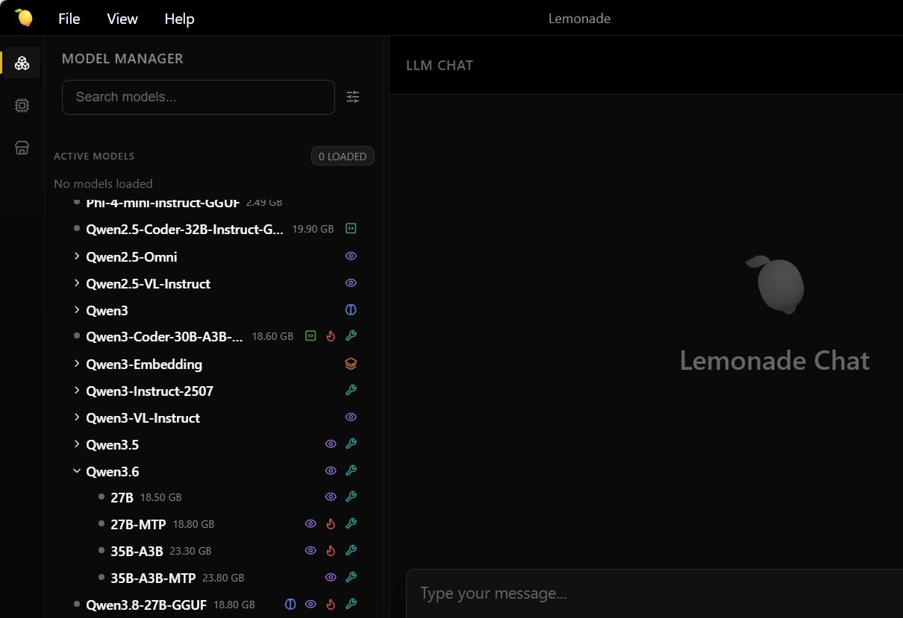
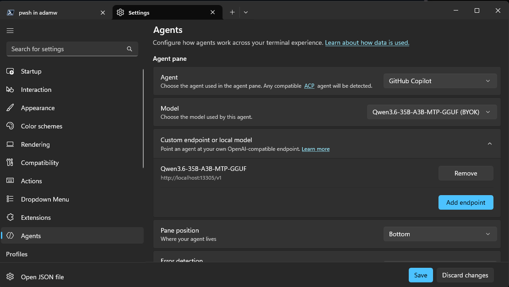
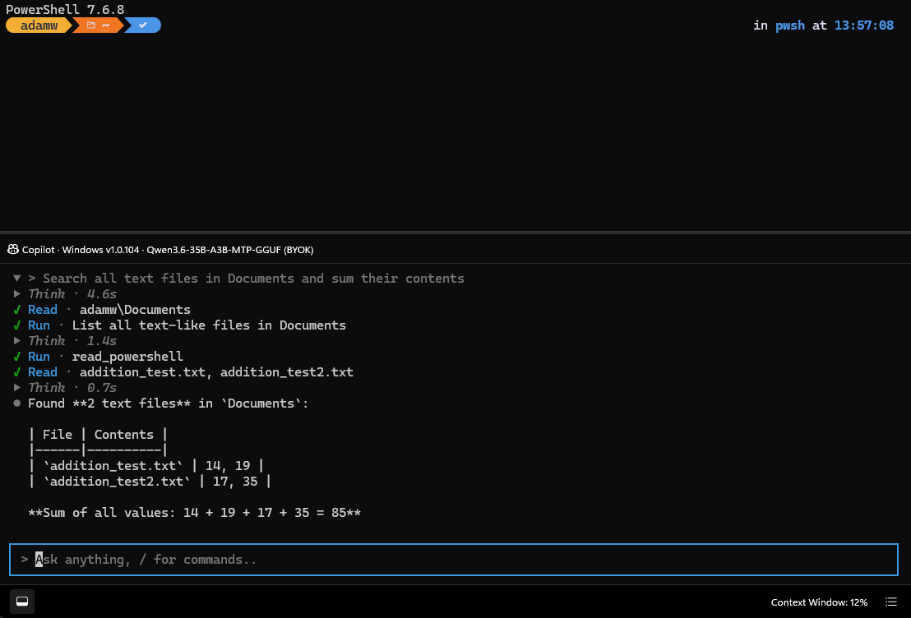

<!--
Copyright Advanced Micro Devices, Inc.

SPDX-License-Identifier: MIT
-->

<!-- @github-only -->
> [!IMPORTANT]
> This playbook uses special tags that GitHub cannot render. Please visit [amd.com/playbooks](https://amd.com/playbooks) to correctly preview this content.
<!-- @github-only:end -->

## Overview

Just received your Windows Ryzen AI Halo?

Your **Ryzen™ AI Halo** arrives with Windows already set up for local AI development. The image ships AMD's AI stack — **Lemonade Server**, **ComfyUI**, and a **ROCm™-enabled PyTorch** — alongside **Microsoft Project Zenith**, a preconfigured Windows developer environment with a modern toolchain and agentic terminal apps.

In this tour, you'll find out what is already installed, what has been preconfigured for you, and how to get up and running ASAP.


## What You'll Learn

By the end of this playbook you will be able to:

* **Identify the AI software** that ships on your Ryzen AI Halo and know what each piece is for.
* **Recognise the Windows and toolchain settings** that have been preconfigured for you.
* **Start Lemonade Server**, download a model, and confirm its OpenAI-compatible endpoint is live.
* **Connect Intelligent Terminal** to your local Lemonade model.
* **Connect GitHub Copilot CLI** to the same local endpoint (optional).
* **Choose between local and cloud models** depending on the task.

## Check for Software Updates

<!-- @require:software-update -->

## Setting the Memory Configuration

<!-- @require:memory-config -->

---

## Part 1 — What's On Your Machine

### The AMD AI stack

These are the components that make the Ryzen AI Halo a local AI machine. All three are preinstalled.

| Software | What it does | How to start it |
|----------|--------------|-----------------|
| **Lemonade Server** | Local LLM server with an OpenAI-compatible API. Runs models on your GPU and NPU, and is what lets other apps use local models. | Start menu → **Lemonade Server** |
| **ComfyUI** | Node-graph application for image and diffusion models. Self-contained with its own runtime. | Desktop shortcut |
| **PyTorch with ROCm** | GPU-accelerated PyTorch, preinstalled into the system Python. | `python` in any terminal |

### The Zenith developer toolchain

Project Zenith from Microsoft adds a modern Windows development environment. The headline additions:

| Tool | What it's for |
|------|---------------|
| **Intelligent Terminal** | Terminal with a built-in AI agent pane. Ask for a command in plain language instead of recalling syntax. Open the agent pane with `Ctrl+Shift+.` |
| **GitHub Copilot CLI** | Agentic coding in the terminal — plans multi-step work, edits files, runs commands with your approval. Has its own profile in the Terminal dropdown. |
| **WSL 2 with Ubuntu** | A full Linux environment for Linux-first ML tooling. Run `wsl` to enter. `wslc` creates and runs Linux containers. |
| **uv** | Fast Python package and environment manager. Use `uv venv` and `uv pip install` in place of pip. |
| **PowerShell 7** | The default shell, replacing the older Windows PowerShell 5. |
| **PowerToys** | Utilities including Command Palette (`Win+Alt+Space`) and FancyZones window tiling. |

Also included: Git, Visual Studio Code, Node.js with nvm, .NET SDK 10, GitHub CLI, Azure CLI, Windows App CLI (`winapp`), Oh My Posh, and Coreutils for Windows.

### Windows settings already configured for you

Zenith presets a number of Windows and shell settings that developers commonly change by hand. Nothing here is required reading — it's listed so you know what was deliberate rather than accidental.

| Setting | Configured as | Why it helps |
|---------|---------------|--------------|
| Default shell | PowerShell 7 | Modern shell features; the older PowerShell 5 is no longer the default |
| Long path support | Enabled | Deep dependency trees no longer hit the 260-character path limit |
| File Explorer | Full path shown in title bar | Easier to see when working across many project folders |
| Appearance | Dark mode | Set as the default for new users |
| Terminal font | Cascadia Mono NF | Includes the glyphs that CLI tools expect |
| Prompt | Oh My Posh | Shows Git branch and Python environment in the prompt |
| `ls` behaviour | Coreutils | `ls`, `cat`, and `grep` behave as they do on Linux |
| Taskbar | Terminal, VS Code, AMD Ryzen AI Developer Center pinned | The tools you'll use most are one click away |

---

## Part 2 — Running a Local Model

Lemonade is a local-LLM server optimized for AMD local inference. 

### Step 1 — Start Lemonade Server

Open **Lemonade** by clicking the shortcut or through Windows Start, then confirm it's running by opening the web GUI at `http://localhost:13305`.

<!-- @require:lemonade-ready -->

### Step 2 — Download a model

**No models ship with the image** — open Lemonade to choose your model and download it.

> [!TIP]
> You may need to open the web UI from the toolbar in the bottom right.

<!-- Screenshot: loading the lemonade Model to help users find it -->
<p align="center">
  
</p>

Two recommendations for agentic work on Ryzen AI Halo:

| Model | Type | Why choose it |
|-------|------|---------------|
| **Qwen3.8 27B** | Dense | Every parameter is used for each token, which generally means stronger reasoning on hard problems. Slower to generate, since speed here is limited by memory bandwidth. |
| **Qwen3.6 35B-A3B MTP** | Mixture-of-experts | Only a fraction of its parameters activate per token, so it generates noticeably faster than a dense model of similar size while still being a large model. |

Both fit in the Ryzen AI Halo's unified memory. If you're unsure, start with the MoE model — responsiveness matters more than raw capability for day-to-day coding, and you can always switch.


> [!TIP]
> **For agent work, consider turning off thinking mode.** Qwen3.6-35B-A3B thinks before every response by default, and that latency compounds quickly in agent loops. The [lemonade-sdk/recipes](https://github.com/lemonade-sdk/recipes/blob/main/coding-agents/Qwen3.6-35B-A3B-NoThinking.json) repo publishes a ready-made config that disables it:
>
> ```powershell
> curl.exe -LO https://raw.githubusercontent.com/lemonade-sdk/recipes/main/coding-agents/Qwen3.6-35B-A3B-NoThinking.json
> lemonade import Qwen3.6-35B-A3B-NoThinking.json
> ```

### Step 3 — Find your model name

The agent tools need the model name exactly as Lemonade reports it. List what's loaded with the CLI:

<!-- @test:id=zenith-lemonade-models timeout=60 -->
```powershell
curl.exe http://localhost:13305/api/v1/models
```
<!-- @test:end -->

Or, simply note the name of the model in the UI — you'll paste it in the next part.

> [!TIP]
> Your Lemonade endpoint is `http://localhost:13305/v1`. No API key is needed, but some apps require the field to be non-empty — enter any placeholder text when asked.

---

## Part 3 — Connecting the Zenith Agent Tools

Many apps point first to Cloud subscriptions. Instead, here's how to point them at the free local model you just started.

### Connecting Intelligent Terminal

Intelligent Terminal adds an agent pane to your standard terminal, so you can use natural language to help write and understand terminal outputs.

1. Open **Intelligent Terminal** from the Start menu. It's a separate app from the classic Windows Terminal.
2. Open the agent's settings and find the **BYOM** (bring your own model) or **Custom endpoint or local model** section.
3. Select **Add New** and enter:
   - **Base URL:** `http://localhost:13305/v1`
   - **Model ID:** the model name you noted in Part 2, Step 3
4. Save, then select your new provider from the model dropdown. Custom models appear with a `(BYOK)` suffix.

<!-- Screenshot: the BYOM / custom endpoint dialog with Base URL and Model ID filled in, just before saving. -->
<p align="center">
  
</p>

5. Press `Ctrl+Shift+.` to open the agent pane and ask it something. It can navigate your folders, write to files, and help you with complex terminal commands.

> [!TIP]
> Your prompts now go to the model running on your own GPU and NPU. Nothing leaves the machine — you can confirm it by watching Lemonade's web UI light up with activity as the agent works.


<!-- Screenshot: the terminal with the agent pane open, mid-task — e.g. reading a file or navigating a folder — with the local (BYOK) model selected and visible. -->
<p align="center">
  
</p>

> [!NOTE]
> Intelligent Terminal stores endpoint credentials in Windows Credential Manager rather than a settings file. To change a key later, remove the endpoint and add it again.

### Optional: Connecting GitHub Copilot CLI

> [!IMPORTANT]
> **You must sign in to GitHub before you can configure a local model.** Copilot CLI puts custom provider configuration behind GitHub account authentication, so the sign-in step is unavoidable even though your end state is entirely local. A free GitHub Copilot account is sufficient.

Copilot CLI is already on your PATH and has a dedicated profile in the Terminal dropdown.

1. Open **Windows Terminal** and select the **GitHub Copilot** profile, or run `copilot` from any shell.
2. Complete the initial setup if you haven't already.
3. Configure a custom OpenAI-compatible provider pointing at the Lemonade endpoint (`http://localhost:13305/v1`) with your model name.

Useful commands once you're in:

| Command | What it does |
|---------|--------------|
| `/plan` | Drafts an implementation plan before writing any code |
| `Shift+Tab` | Cycles agent modes, including autopilot |
| `/resume` | Picks up a previous session with its context |

### Choosing local or cloud

Both tools can switch between providers, which makes a two-tier workflow practical:

- **Local (Lemonade)** — day-to-day coding, refactoring, explaining code, iterating. Unlimited, private, works offline.
- **Cloud** — occasional problems where you want a frontier model's extra capability.

Most work fits comfortably in the first category, which is the point of having this much local compute.

---

## Where to Go Next

| If you want to… | Try this playbook |
|-----------------|-------------------|
| Learn Lemonade in depth — vision, speech, image generation, backends | [Getting Started with Lemonade](https://developer.amd.com/playbooks/lemonade-getting-started) |
| Generate images with a node-based workflow | [Generating Images with ComfyUI and Z Image Turbo](https://developer.amd.com/playbooks/comfyui-image-gen) |
| Use a local model inside VS Code | [Local LLM Coding with VSCode and Qwen3-Coder](https://developer.amd.com/playbooks/vscode-qwen3-coder) |
| Build agentic workflows on a local server | [Running OpenClaw Locally with Lemonade Server](https://developer.amd.com/playbooks/openclaw-lemonade-server) |
| Fine-tune a model on your own data | [Fine-Tuning LLMs with Unsloth](https://developer.amd.com/playbooks/unsloth-llms-finetuning) |

## Troubleshooting

### The agent tool can't reach the model

Lemonade doesn't start at logon — open it from the Start menu. To confirm the server is up:

<!-- @test:id=zenith-lemonade-status timeout=60 -->
```powershell
lemonade status
```
<!-- @test:end -->

### The model name is rejected

It must match the name Lemonade reports exactly. Re-run the `/api/v1/models` command and copy the value verbatim.

### Checking ROCm PyTorch

Your GPU should be available to PyTorch with no setup. To verify:

<!-- @test:id=zenith-torch-check timeout=120 -->
```powershell
python -c "import torch; print('GPU available:', torch.cuda.is_available())"
```
<!-- @test:end -->

If this returns `False`, open **AMD Ryzen AI Developer Center** from the taskbar, install any pending updates, and reboot.

### Responses are slow with a large model

Token generation is limited by memory bandwidth rather than capacity, so a larger model doesn't simply run slower in proportion to its size. Switch to a mixture-of-experts model such as Qwen3.6 35B MTP, which activates only a fraction of its parameters per token and generates considerably faster than a dense model of similar size.

### The model dropdown is empty

No models ship with the image. Download one through Lemonade's Model Manager first — see Part 2, Step 2.
